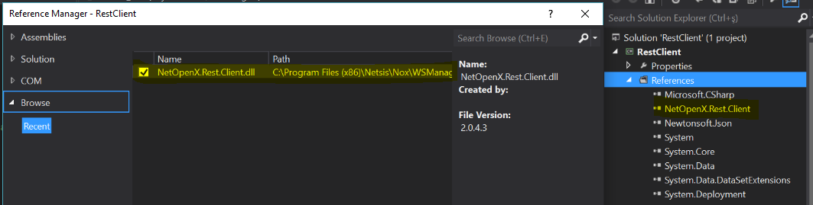

> Bu sayfa Logo DYS "Netsis Uyarlama Araçları" dokümantasyonunun bir kopyasıdır. İçerik Logo Yazılım'a aittir. Kaynak: [1 - Projeye Başlarken](https://dys.logo.cloud/external?cid=0679833b-8fdb-4390-8c03-a24c02d0441c&link=3f227767-2e20-40ee-8f25-113e29bd7d5c&tenantId=cdd87e13-3009-4dd1-a5b8-2a005c0e58da&hideName=True&locale=tr_TR)

# 1 - Projeye Başlarken

**Geliştirme Ortamı**

_Burada verilecek örnekler Visual Studio üzerinden anlatılacaktır._

Visual Studio ortamında geliştirme yapabilmek için ilk olarak Visual Studio üzerinden References sekmesinden , browse tabı altından kurulumun yapıldığı dizin seçilerek (_C:\\Program Files (x86)\\Netsis\\Nox\\WSManager\\Documents\\RestClient_)  NetOpenX.Rest.Client.dll dosyası projeye eklenmelidir.



**Token Alma**

Geliştirilecek proje için, uygulama içerisinde yapılacak ilk adım token alma işlemidir. Kurulum ile birlikte default olarak token geçerlilik süresi 20 dk olarak tanımlı gelir. Bu süre NetOpenX Rest Manager ekranından Access token geçerlilik süresi alanından değiştirilebilinir. Token bilgisi bulunmayan veya süresi dolmuş token ile gelen istekler REST servisi tarafından cevaplanmaz. Süresi dolmuş token için yeniden access token alınmalıdır.

```
using System;
using System.Collections.Generic;
using System.ComponentModel;
using System.Data;
using System.Drawing;
using System.Linq;
using System.Text;
using System.Threading.Tasks;
using System.Windows.Forms;
using NetOpenX.Rest.Client;
using NetOpenX.Rest.Client.Model;
using NetOpenX.Rest.Client.BLL;
using NetOpenX.Rest.Client.Model.NetOpenX;
using NetOpenX.Rest.Client.Model.Enums;
 
namespace RestClient
{
    public partial class Form1 : Form
    {
        public Form1()
        {
            InitializeComponent();
        }
        private oAuth2 _oAuth2=null;
 
        private void button1_Click(object sender, EventArgs e)
        {
            _oAuth2 = new oAuth2("http://localhost:7070"); //yayın yapılacak sunucu adresi
            _oAuth2.Login(new JLogin()
            {
                BranchCode = 0,   //sube kodu bilgisi
                NetsisUser = "netsis", //netsis kullanıcı adı bilgisi
                NetsisPassword = "NET1", //netsis şifre bilgisi
                DbType = JNVTTipi.vtMSSQL, //veritabanı tipi
                DbName = "REMDA2016", //şirket bilgisi
                DbPassword = "", //veritabanı şifre bilgisi
                DbUser = "TEMELSET" //veritabanı kullanıcı adı bilgisi
            });
 
             
            richTextBox1.Text = _oAuth2.AccessToken;
        }
    }
}
```
