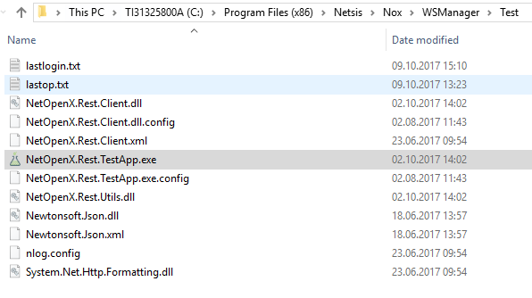
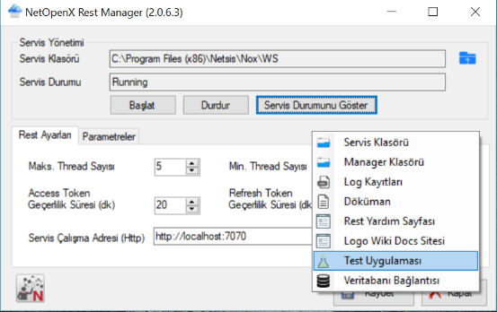
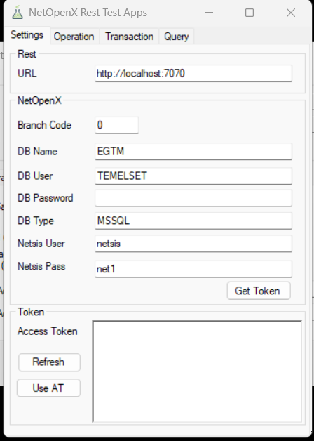
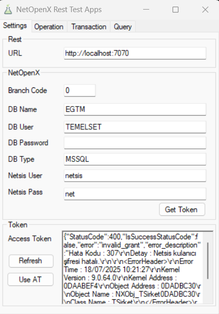
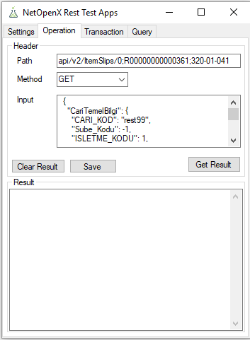
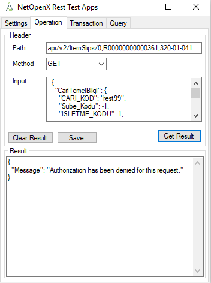
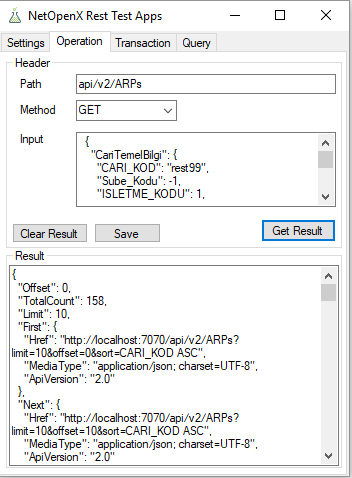
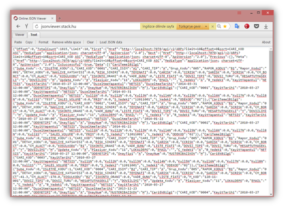
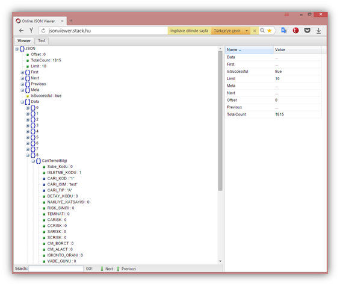
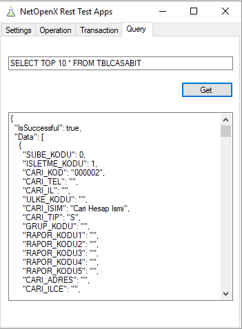

> Bu sayfa Logo DYS "Netsis Uyarlama Araçları" dokümantasyonunun bir kopyasıdır. İçerik Logo Yazılım'a aittir. Kaynak: [NetOpenX Rest Test Apps](https://dys.logo.cloud/external?cid=dfc3168a-62b5-4966-9632-99a874fc45bb&link=fec06026-5ecf-4387-99ba-70c1576c21a6&tenantId=cdd87e13-3009-4dd1-a5b8-2a005c0e58da&hideName=True&locale=tr_TR)

# NetOpenX Rest Test Apps

NetOepnX test application ekranı, **“**_C:\\Program Files (x86)\\Netsis\\Nox\\WSManager\\Test”_ yolundan ya da kurulumdan sonra masa üstüne  gelen NetOpenX Rest Manager ekranını çalıştırarak sağ klik ile erişilir.

    

TestApp açıldıktan sonra setting tabında veritabanı, şirket ve kullanıcı bilgileri doldurulur.

**URL**                    : Rest yayını yapılacak sunucu adresi girilir.

**Branch Code    :** Şube kodu bilgisi girilmelidir.

**DB Name          :** Veritabanı ismi yazılmalıdır.

**DB Password  :** Veritabanı şifresi yazılmalıdır.

**Netsis User    :** Netsis kullanıcı ismi yazılmalıdır.

**Netsis Pass    :** Netsis şifresi yazılmalıdır.

   

Gerekli alanlar doldurulduktan sonra, **“Get Token”**  butonuna basılarak  Access Token oluşturulur. 

Access Token alanına aşağıdaki şekildeki gibi bir veri gelirse, Token alma işlemide başarılı olmamış demektir.

   

_{"StatusCode":400,"**IsSuccessStatusCode":false**,"error":"invalid\_grant","error\_description":"\\r\\nSQL : Select Sube\_Kodu,MeRKEZMI,ISLETME\_KODU FROM TBLSUBELER WITH (NOLOCK)  Where Sube\_Kodu = 0\\r\\n\\r\\nLogin failed for user 'sa'.(NetsisMS-42000,18456)\\r\\n | NetOpenX50.Kernel"}_

Bu durumda veritabanı bilgileri bir kez daha kontrol edilmelidir. DB User ve DB Password bilgileri VT\_GUVENLIK dosyasının açık ya da kapalı olması durumuna göre değişkenlik gösterir. Eğer VT\_GUVENLIK dosyası kapalı ise SQL e login olunan kullanıcı adı ve şifresi ile, VT\_GUVENLIK dosyası açık ise registry bilgilerine göre DB name ve password alanlarını doldurarak token işlemi kontrol edilmelidir. NetOpenX login bilgileri doğru ise, servis durmuş olabilir, **NetOpenXRestManager** _(NetOpenX.Rest.Service.WSManager.exe)_  ile servisin çalışır durumda olduğu kontrol edilmelidir.

Token alma işlemi başarılı ise Settings tabında aşağıdaki ekran görüntüsünde olduğu gibi token bilgisi oluşur, Ardından otomatik olarak Operation tabı aktif olur.

       

Get Result Butonuna basıldığında aşağıdaki hata geliyorsa, token süresi dolmuş demektir. Önceki taba gelerek, tekrar Get Token işlemi yapılması gerekmektedir. 

   

Token başarı ile alınıp **Operation Tabı** aktif olduktan sonra, bu ekranda header bölümüne path, method, input bilgileri girilir.  
  
**\- Path        :** [http://localhost:7070/api/v2/help](http://localhost:7070/api/v2/help) adresinde  detaylarını bulanan, kullanılacak _API_ bilgisi girilir

**\- Method  :** İlgili hangi metodun, yani hangi “paket tipi”nin kullanılacağı bilgisidir.

**\- Input       :** Method olarak PUT ya da POST kullanımı sırasında gerekli bilginin yazıldığı alandır.

Ardından “Get Result” butonuna basılır.

     

Result kısmına gelen bilgi, elde edilmek istenen sonuç bilgisini döndürür. Buradaki JSON stringi bir online JSON viewer kullanarak, formatlı ve düzgün şekilde görüntülenebilinir. (örnek site : [http://jsonviewver.stack.hu](http://jsonviewver.stack.hu/) )

‘Text’ kısmına yazılan JSON, ‘Viewer’ sekmesinde görüntülenebilinir.

Ek olarak, ‘Query’ tab ı altından JSON formatında serbest bilgi döndürülebilinir.

      

.
