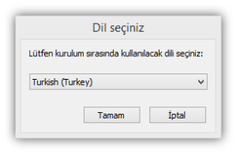
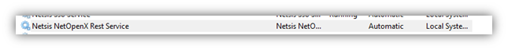
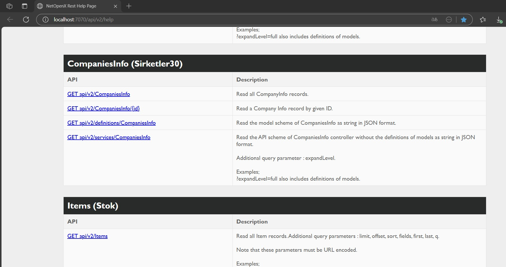

> Bu sayfa Logo DYS "Netsis Uyarlama Araçları" dokümantasyonunun bir kopyasıdır. İçerik Logo Yazılım'a aittir. Kaynak: [NetsisNoxRestSetup.exe ile Kurulum](https://dys.logo.cloud/external?cid=ad90788e-31d9-4f7a-8ded-703eef6d6b00&link=98a8075c-a0c1-49cf-b9e7-2223ab7bea74&tenantId=cdd87e13-3009-4dd1-a5b8-2a005c0e58da&hideName=True&locale=tr_TR)

# NetsisNoxRestSetup.exe ile Kurulum

Rest kurulumu için indirmeniz gereken setup dosyası kullandığınız Netsis versiyonu ile uyumlu olduğundan emin olmalısınız.

**A. NetOpenX Rest Tanımı**  
NetOpenX Rest, netopenx işlevlerinin gerçekleştirilebileceği ve JSON formatında veri geri döndüren kullanıcı dostu web uygulamasıdır.

**B. Temel Gereklilikler**  
Netsis Temelset 8.06 ve üzeri sürüm yüklü olması gerekmektedir.  
  
**C. Kurulum Adımları**  
Netsis NetOpenX Rest Kurulumu için  NetsisNoxRestSetup.exe “Yönetici olarak çalıştır(Run As Administrator)” denilerek çalıştırılmalıdır.  
  
**Kurulum Dili**  
Kurulum dili Türkçe ya da İngilizce olarak belirlenir.

**Kuruluma Geçiş**  
Açılan kurulum ekranından “İleri” butonuna basılarak, ön koşulların kontrol edildiği sayfaya geçilir.

.jpg)

**Koşulların Kontrolü**

.jpg)

Bu ekrandaki kontrollerin tamamı “Başarılı” ise “İleri” butonu ile devam edebilir, aksi durumda ilgili maddeyi aşağıda belirtilen açıklamalara göre kurabilirsiniz:

-   **Gerekli olan minimum Microsoft .Net Framework Versiyonu:**

Microsoft.NET Framework Version 4.0 [http://www.microsoft.com/download/en/details.aspx?id=17851](http://www.microsoft.com/download/en/details.aspx?id=17851)  linkinden uygulamanın kurulacağı sunucuya yüklenebilir.

-   · **Gerekli olan minimum Netsis Temelset Versiyonu:**

Versiyonun 8.06 ve üzeri olması gerekmektedir.

**Özellik Seçimi**

Seçili değil ise, hem “NetOpenX Rest Yönetim Paneli” hem de “NetOpenX Rest” sağ tık Diske Yükle seçeneği ile seçilerek “İleri” butonuna basılmalıdır.

.jpg)

**Netsis Merkezi Kimlik Denetimi Servis Konfigürasyonu**

.jpg)

**SSO Service Adresi:** SSO kurulumundan sonra oluşan servisin ismi yazılır. “Bul” butonuna basıldığında ağdaki tüm SSO servisleri listelenir. Arasından kurulum yapılan sunucunun servis bilgisi seçilebilir ya da “sunucu adı:2023/NetsisSsoService” formatında elle de yazılabilir.

**D. Kurulum Sonrası Genel Bilgiler  
  
1.Kurulum Dizini**

Sanal dizinde belirtilen adrese kurulum gerçekleştirilmiş olur. Varsayılanda _C:\\Program Files (x86)\\Netsis\\Nox_ altına kurulur. **_WS_** ve **_WSManager_** klasörleri oluşturulur.  
.jpg)

**2\. Service**  
Servisler (Win+R / services.msc) altında **_Netsis NetOpenX Rest Service_** adı ile kurulur.

**E. Kurulum sonrası Testler  
  
1\. Servis çalışırlık testi ve ayarları**  
_C:\\Program Files (x86)\\Netsis\\Nox\\WSManager_ altında **NetOpenX.Rest.Service.WSManager.exe** bulunur.

.jpg)

**NetOpenX Rest WSManager.exe** bize servisin durumunu ve özelliklerini gösteren ve üzerinde değişiklik yapıp, log durumlarını kolayca görüntülememize olanak sağlayan bir ara uygulama ve test aracıdır.

Ardından, sol alttaki Netsis kimlik yönetimi ikonuna basılır, böylece SSO servis yapılandırma değerleri tekrar okunması sağlanır.

.jpg)

Ardından ‘**Kaydet**’ butonuna basılır. 

Eğer servis durumu ‘Stopped’ – durmuş halde ise, ‘Başlat’butonuna basılarak servis başlatılır. Servisin güncel durumu ‘Servis Durumunu Göster’ ile uygulamaya yansıtılır.  
  
Herhangi bir hata – çalışmama durumunda sağ alttaki ‘Log’ butonuna basılarak hata detayı görüntülenebilir. Bu buton **C:\\Program Files (x86)\\Netsis\\Nox\\WS\\log** klasörünü açar. Buradaki log dosyalarından detay araştırılabilir.

**2\. Help sayfasına erişim kontrolü**

Kurulum sonrası, ya da uygulamaya erişmeden önce kurulum dokümanında bahsedilen servislerin çalışır durumda olduğunun testinin yapılması gerekmektedir.

Bu test sonrası servisler çalışır durumda görünüyor ise adresi yardım sayfasına;  
[http://localhost:7070/api/v2/help](http://localhost:7070/api/v2/help) üzerinden ulaşılabilir. Desteklenen tüm fonksiyon, aldıkları parametre ve nesne tiplerine detaylıca erişilmektedir. NetOpenX karşılıkları parantez içerisinde verilmiştir, NetOpenX karşılığı bilinen bir fonksiyonun Rest karşılığı bu şekilde bulunabilir. 

Bu adres üzerinden ihtiyacımız olan kullanılacak API adresleri seçilir. Bu bilgileri kullanacağımız aracımız ise **“NetOpenX.Rest.TestApp.exe”** nin Operation Sekmesinin ‘Path’ alanıdır.

**\*NetOpenX.Rest.TestApp.exe, Rest kullanımında verilerin doğru alınıp gönderilebildiğini gözlememizi sağlayan test aracıdır.  NetOpenX  Rest Test Application dokümanını incelemek için lütfen **[tıklayınız](netopenx-rest-test-apps.md).****
