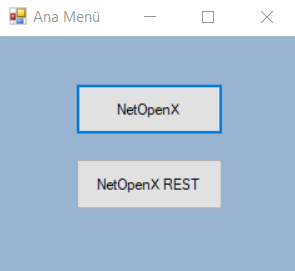
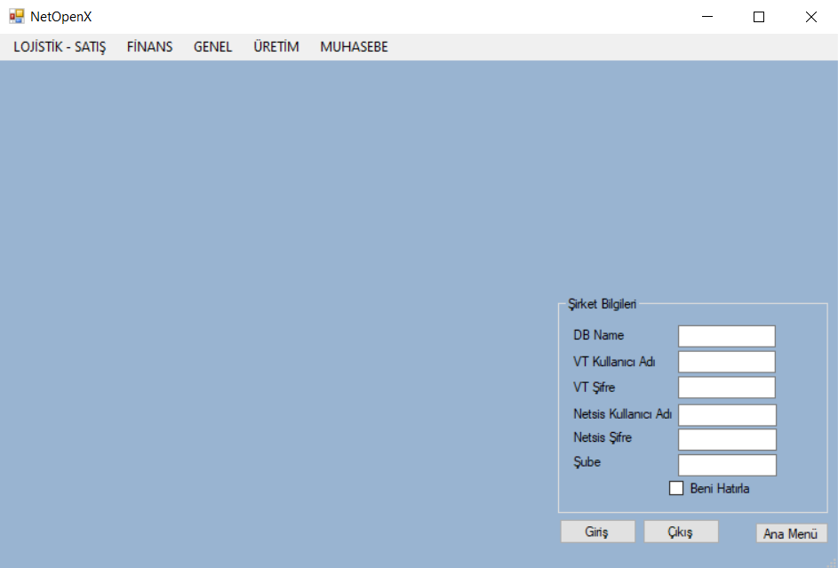
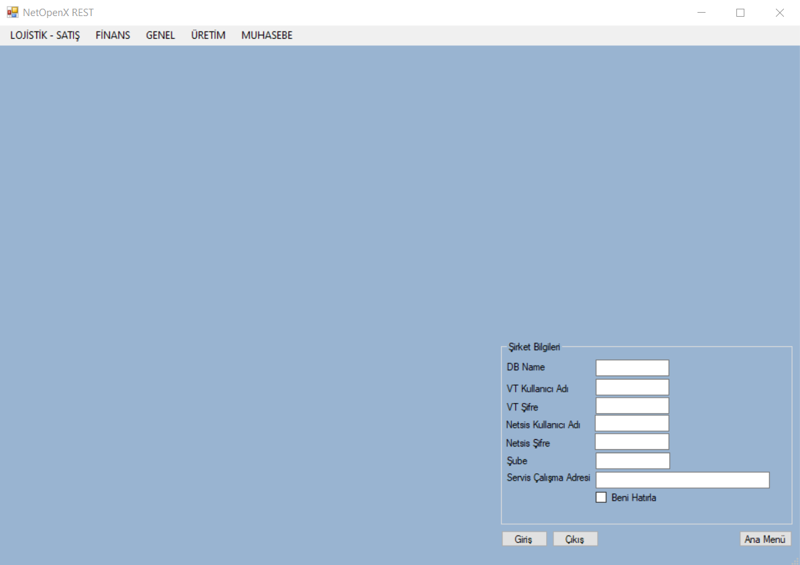
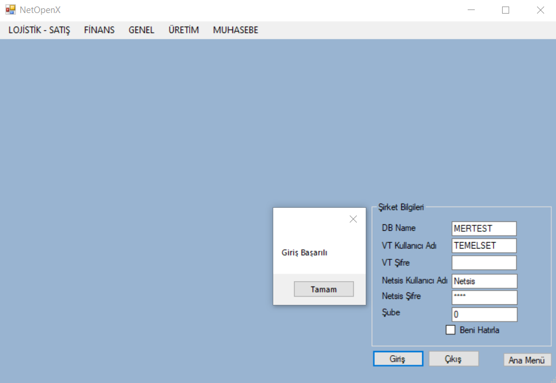
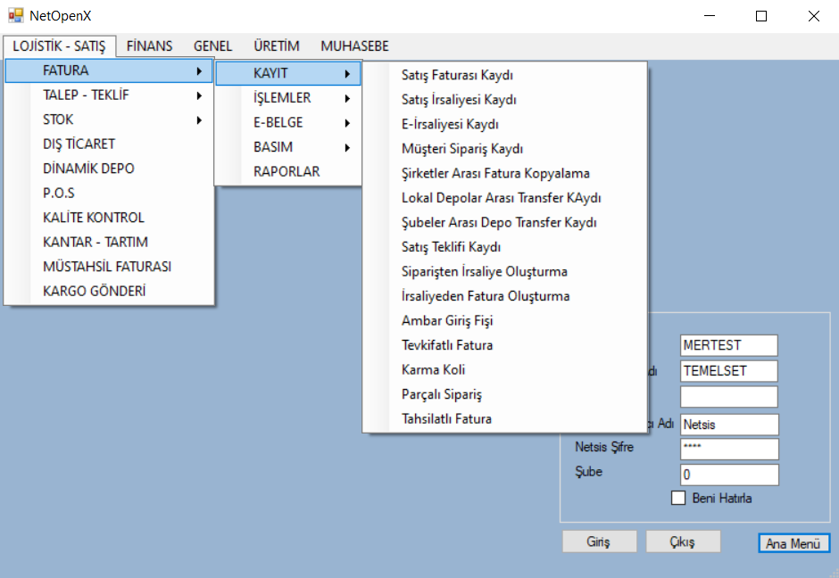
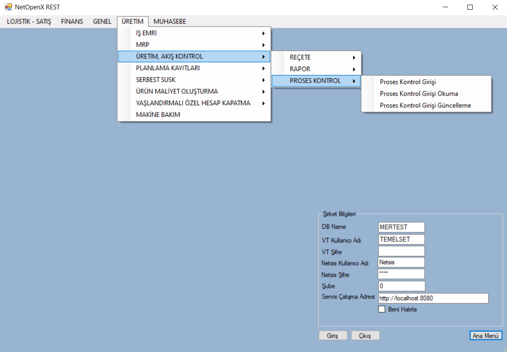

> Bu sayfa Logo DYS "Netsis Uyarlama Araçları" dokümantasyonunun bir kopyasıdır. İçerik Logo Yazılım'a aittir. Kaynak: [NetOpenX ve Rest Client C# Proje](https://dys.logo.cloud/external?cid=7035c039-10d4-4d07-acec-71c0bfe7b429&link=6fe296a4-ad2a-4f8f-8fb1-645c0d4525a2&tenantId=cdd87e13-3009-4dd1-a5b8-2a005c0e58da&hideName=True&locale=tr_TR)

# NetOpenX ve Rest Client C# Proje

Bu başlıkta paylaşılan proje NetOpenX ve Rest Client ile desteklenen uçların örnek kodlarını kapsamaktadır. Bu projenin eklenmesindeki amaç kendi projenizi oluşturmanıza yardımcı olmaktır. Proje üzerinde işlemler yapılmadan önce kod tarafında yapılacak işlem için  gerekli olan parametreler doldurulduktan sonra proje tekrar çalıştırılmalıdır.

**C# Proje Ana Menü**

Kullanıcı açılışta bu ekran ile karşılaşmaktadır. Buradan kullanacağı alanı seçerek ilerlemelidir.

**NetOpenX ve NetOpenX Rest Menüleri** 

Ana menüdeki seçime göre kullanıcının önüne gelecek ekranlar aşağıdaki gibidir. Bu aşamada ilk yapılması gereken işlem şirket bilgilerinin doğru bir şekilde doldurulduğundan emin olduktan sonra giriş yapmaktır.

 

Giriş yapıldıktan sonra kırımlardan NetOpenX veya NetOpenX Rest tarafından desteklenen uçlarla işlemler yapılmaktadır.

**Proje Dosyaları** 

[DocProje.zip](../../ekler/DocProje.zip)
