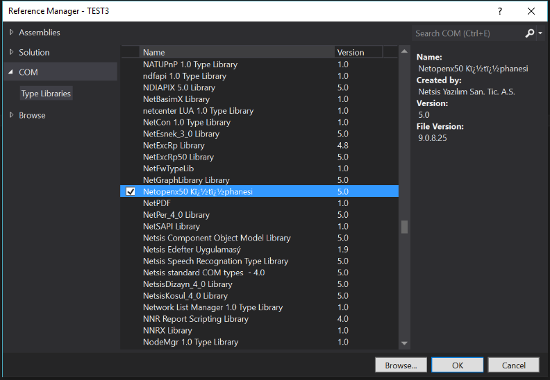
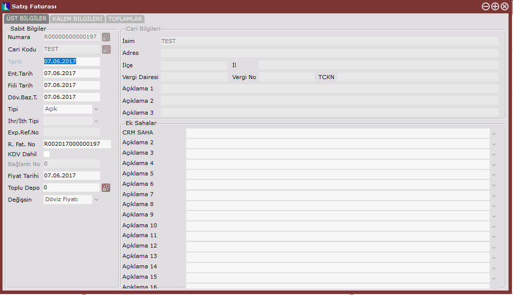
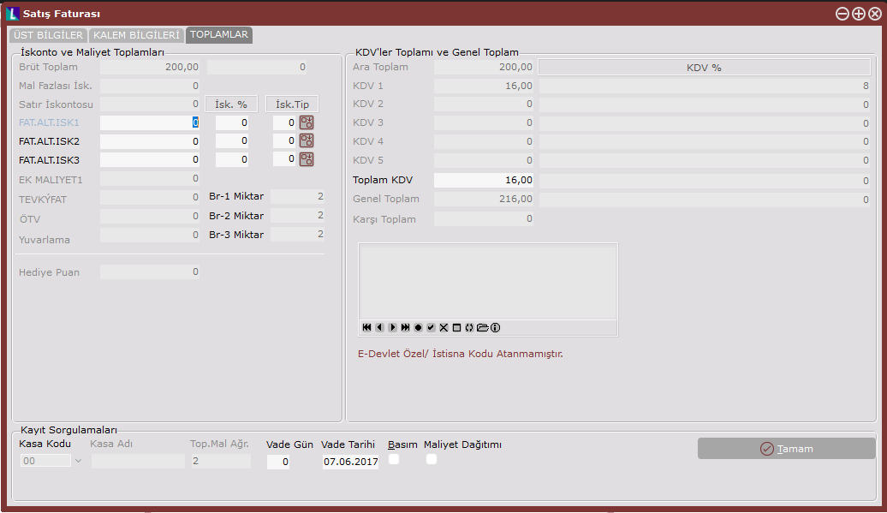
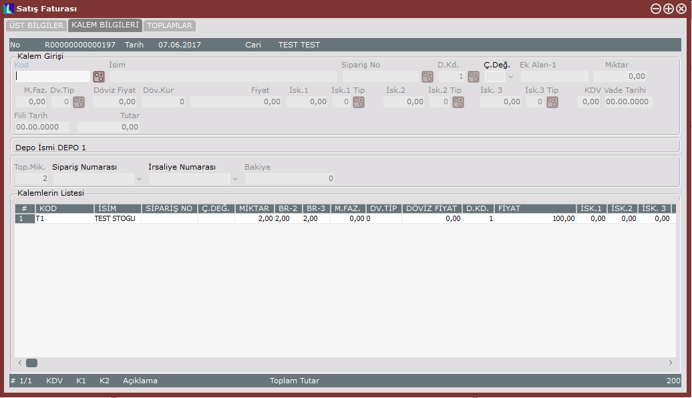

> Bu sayfa Logo DYS "Netsis Uyarlama Araçları" dokümantasyonunun bir kopyasıdır. İçerik Logo Yazılım'a aittir. Kaynak: [NetOpenx - Başlangıç](https://dys.logo.cloud/external?cid=0b5a0b97-2aff-4ab9-b22f-babc96b13e9b&link=57b59bd7-412c-4ebc-aee6-252889e31077&tenantId=cdd87e13-3009-4dd1-a5b8-2a005c0e58da&hideName=True&locale=tr_TR)

# NetOpenx - Başlangıç

## Geliştirme Ortamı

Geliştireceğiniz projenizi COM nesnelerini referans olarak ekleyip kod yazabileceğiniz tüm geliştirme platformlarını kullanma şansınız var.

Örneğin ;

-   Visual Studio
-   Delphi
-   SQL Server …

Burada örneklerimizi Visual Studio üzerinden vereceğiz.

Visual Studio ortamında geliştirme yapabilmek için ilk olarak Visual Studio üzerinden Netopenx50.dll dosyası References sekmesinden COM tabı altından eklenmeli ve Netopenx50.dll dosyası register edilmiş olmalıdır.



  
Burada yapılması gereken NetOpenX bir COM dll ‘i olduğundan dolayı **COM** altından NetOpenX50 Kütüphanesi reference olarak projeye eklenmeli.

\*\*\* Com tabı altında NetOpenX Kütüphanesi görünmüyor yada farklı bilgi ile görünüyor ise NetOpenX dll’in yanlış yada hiç register edilmediği anlamına gelmektedir. Bu durum karşısında ilk olarak register işlemi gerçekleştirilmelidir.

## Register İşlemleri

NetOpenX register işlemi için ürünün kurulumunun yapıldığı   C:\\…\\ENTERPRISE9\\Servis klasörü altından administrator olarak  RegControl.exe çalıştırıldığında register işlemlerini gerçekleştirmiş olursunuz.

Manuel olarak register işlemi için ise komut satırını admin olarak çalıştırılmalıdır.

        **->** (Install için) regsvr32.exe Dll\_Dosya\_Yolu

        **->** (Uninstall için) regsvr32.exe Dll\_Dosya\_Yolu /u

Kullanım yöntemi ise yukarıdaki şekildedir.

## NetOpenX ile bağlantı kurulması

NetOpenX temel olarak yaptığı işlem aktarım aracı görevi adı altında Netsis Nesnelerinin **ERP** uygulamasına aktarılmasını (insert,update,delete) sağlar.

ERP nesnelerine erişim için ilk olarak namespace olarak NetOpenx projeye eklenmelidir.

Akabinde işlem yapabilmeka adına Kernel açılmalı ve kernel  sonrasında şirket açılması gereklidir.

**Bağlantı Nesnesi**

```
using NetOpenX50; //Netopenx referanslarının kullanılabilmesi için eklenen namespace
 
Kernel kernel = new Kernel();           
Sirket sirket = default(Sirket);
         
             sirket = kernel.yeniSirket(TVTTipi.vtMSSQL,
                                           "vt adi",
                                           "vt kull adi",
                                           "vt kull sifre",
                                           "netsis kull adi",
                                           "netsis sifre",0)
```

**Fatura Örneği :**

Örnekte satış faturası örneği gösterilmiştir.

**1)** Ürün(aşağıdaki ekran görüntüsü Netsis 3 ürün grubuna aittir) üzerinden fatura üst bilgileri, kalem ve toplam bilgileri doldurularak fatura  oluşturma örneği gösterilmiştir.







**2)** Kod ile gerçekleştirilebilecek örnek yapısı aşağıda gösterilmiştir.Bu örnek yapıya Ürün tarafında manuel olarak giriş yaptığınız sahaları ekleyebilirsiniz. Örneğin proje uygulamanız açık ise proje kodu sahası yada seri takibi açık ise stok seri bilgilerini örnek kod bloğuna ekleyerek netopenx ile kayıt işlemini gerçekleştirebilirsiniz.

**Satış Faturası Kaydı**

```
using System;
using System.Runtime.InteropServices;
using NetOpenX50;
namespace NetOpenXTest
{
    public static class FaturaOrnek
    {
        public static void SatisFaturasiKaydet()
        {
            Kernel kernel = new Kernel();
            Sirket sirket = default(Sirket);
            Fatura fatura = default(Fatura);
            FatUst fatUst = default(FatUst);
            FatKalem fatKalem = default(FatKalem);
            try
            {
                sirket = kernel.yeniSirket(TVTTipi.vtMSSQL,
                                              "vt adi",
                                              "vt kull adi",
                                              "vt kull sifre",
                                              "netsis kull adi",
                                              "netsis sifre",
                                              0);
                fatura = kernel.yeniFatura(sirket, TFaturaTip.ftSFat);
                fatUst = fatura.Ust();
                fatUst.FATIRS_NO = fatura.YeniNumara("A");
                fatUst.CariKod = "00002";
                fatUst.Tarih = DateTime.Now;
                fatUst.ENTEGRE_TRH = DateTime.Now;
                fatUst.FiiliTarih = DateTime.Now;
                fatUst.TIPI = TFaturaTipi.ft_Acik;
                fatUst.Proje_Kodu = "1";
                fatUst.KDV_DAHILMI = true;
 
                fatKalem = fatura.kalemYeni("001");
                fatKalem.DEPO_KODU = 2;
                fatKalem.STra_GCMIK = 5;
                fatKalem.STra_NF = 12;
                fatKalem.STra_BF = 12;
                  
                fatura.kayitYeni();
            }
            finally
            {
                Marshal.ReleaseComObject(fatKalem);
                Marshal.ReleaseComObject(fatUst);
                Marshal.ReleaseComObject(fatura);
                Marshal.ReleaseComObject(sirket);
                kernel.FreeNetsisLibrary();
                Marshal.ReleaseComObject(kernel);
            }
        }       
    }
}
```
