> Bu sayfa Logo DYS "Netsis Uyarlama Araçları" dokümantasyonunun bir kopyasıdır. İçerik Logo Yazılım'a aittir. Kaynak: [NDI - Başlangıç](https://dys.logo.cloud/external?cid=8b4beb95-5577-4ffa-8e2f-6c723450b3fc&link=4234ac30-9222-4306-929a-6c62f3e98dd0&tenantId=cdd87e13-3009-4dd1-a5b8-2a005c0e58da&hideName=True&locale=tr_TR)

# NDI - Başlangıç

Bu bölüm Netsis Uyarlama Araçları Eğitiminde anlatılan konuları kapsamaktadır.

NDI Projesi Geliştirme adımları anlatılmıştır.

_Logo Ürünlerinin Uyarlama ve Entegrasyon araçlarını karşılaştırmalı olarak incelemek için_

_kullanabilirsiniz._

# **1\. NDI Geliştirme Ortamı**

Geliştirme ortamı araçları için aşağıdaki şekli inceleyebilirsiniz.

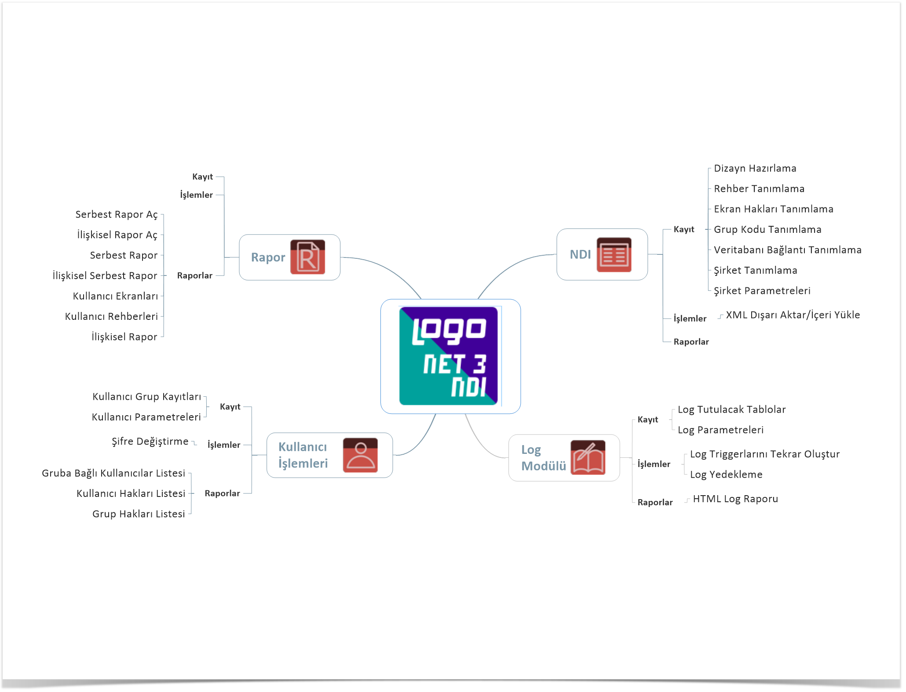

# **2\. Şirket Parametreleri Ayarları**

İlk olarak şirket parametreleri ayarları yapılır. 

**NDI > Kayıt > Şirket Parametreleri** _ile ekran açılır_

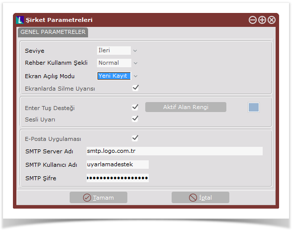

**Şirket Parametreleri...**

**Seviye** : NDI kullanımı İleri/Kolay olmak üzere iki seviyede belirlenebilmektedir.

**İleri seviye**

-   Dizayn Ortamında sağ klik ile açılan menüde Dinamik kodlama menüsü görünür hale gelir. Dizayn Hazırlama/Dizayn Ortamı/VCL (Visual Component Library) bölümündeki “İleri” sayfası ve içindeki bileşenler kullanılabilir.

**Kolay seviye**

-   Dizayn Ortamında sağ klik ile açılan menüde Dinamik kodlama menüsü görünmez olur ve “İleri” seviyedeki bileşenler kullanılamamaktadır.

**Rehber Kullanım Şekli** : Rehberler Normal, Sırasız ve Hızlı olmak üzere 3 çeşittir.

**Normal Rehber**

-   Rehber tipi normal olarak seçildiği zaman rehberdeki sahalar otomatik olarak isim sıralı olarak gelmekte ve rehberdeki bilgilerin tamamı alttaki gridte görülebilmektedir. Kullanıcı isterse daha sonra rehberdeki kayıtları istediği alana göre sıralayabilmektedir.

**Sırasız Rehber**

-   Rehber tipi sırasız olarak seçildiği zaman rehberdeki alanlar belli bir sahaya göre sıralanmadan gelecek, yine normal rehberde olduğu gibi alt gridde rehberdeki kayıtlar görülebilecektir. Sırasız rehberde kayıtlar normal rehberde olduğu gibi sıralanmadan döküldüğü için bu rehber türünde kayıtlar daha hızlı gelmektedir. Dökülen kayıtlar, daha sonra kullanıcı tarafından sıralatılabilir.

**Hızlı rehber**

-   Rehber tipi hızlı olarak seçildiği zaman rehberin grid ekranında hiç bir kayıt gelmeyecek istenilen kod ya da isim yazılıp Enter tuşuna basıldığı zaman kayıtlar görülebilecektir. Hızlı rehber şeklinde kayıtlar çağrılmadan önce grid ekranına hiçbir kayıt gelmediği için, veriler ekrana normal ve sırasız rehbere göre daha hızlı gelmektedir.

**Ekran Açılış Modu :** İlk Kayıt, Yeni Kayıt, Son Kayıt Seçenekleri vardır.

# **3.Veri Tabanı Bağlantı Tanımlama**

NDI uygulaması ile veri tabanları arasındaki bağlantıları tanımlamak amacıyla kullanılır.

**NDI > Kayıt > Veri Tabanı Bağlantı Tanımlama** _ile ekran açılır._

__Tab ile kayıt yapılır.__

Veri tabanı bağlantı ayarlarının çalışıyor olması çok önemlidir.  Rehberdeki seçili bağlantının çalıştığını **test** edebilirsiniz.

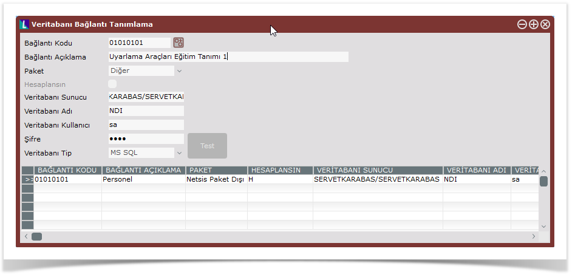

**Veritabanı Bağlantı Tanımlama...**

**Bağlantı Kodu**

-   Tanımlanan her veri tabanı bağlantısı için serbest ve tekrarsız bir kod belirlenmelidir. Kendi sistematiğinize göre burada kodlamanızı yapabilirsiniz. Belirlenen kod dizaynların ve rehberlerin db bağlantı kodu bilgisinde belirtilecek olup, dizaynı ya da rehberi ilgilendiren verinin hangi veri tabanında bulunduğunu tanımlar.

**Bağlantı Açıklama**

-   Veri tabanı bağlantısının açıklamasıdır. Hatırlatma amacıyla açıklayıcı bilgi yazılmalıdır. 

**Paket**

-   NDI, Ticari, Personel, Demirbaş, İşletme, Diğer (Netsis paketleri dışında bir uygulama) paketleri arasından seçilebilir.
-   Netsis paketlerinden birine bağlantı yapılıyorsa, program otomatik olarak ilgili paketin hangi veri tabanı sunucusunda çalıştığını algılar.  

**Hesaplansın**

-   Tanımlanacak Veri tabanı bağlantısı, Netsis’in diğer paketleri içinden kullanılacak nesneler için tanımlanıyorsa, mutlaka hesaplanacak seçeneği işaretlenmelidir.
-   Bu durumda, nesne paketin içinden çalışırken, db bağlantısını kendi içinde çalıştığı paketinkiyle aynı şekilde yapabilecektir.

**VT Sunucu**

-   Netsis paketleri dışında bir paket ile bağlantı yapılacak ise, veri tabanı sunucusunun ismi yazılmalıdır. Netsis paketleri ile bağlantıda, bağlanılacak veri tabanı sunucusu bilgileri, pakete ait kurulum bilgilerinden otomatik alınır ve sorgulanmaz. 

**VT Adı**

-   Bağlanılacak veri tabanının adı belirtilmelidir.  

**VT Kullanıcı**

-   Bağlanılacak veri tabanı için hakları bulunan geçerli bir kullanıcı ismi belirtilmelidir. Dikkat, bu bölümdeki kullanıcı ismi veri tabanı kullanıcısı olup, Netsis paketlerinde tanımlanan kullanıcı isimleriyle ilgisi yoktur. NDI ve Diğer dışında, Netsis paketlerinden bir tanesi için bağlantı tanımlanıyorsa kullanıcı adı sorgulanmayacaktır. Bu durumda, veri tabanı kullanıcı ismi, pakete ait kurulum bilgilerinden otomatik alınır. 

**Şifre**

-   Veri tabanı kullanıcısının veri tabanına bağlanmak için kullandığı şifredir. NDI ve Diğer dışında, Netsis paketlerinden bir tanesi için bağlantı tanımlanıyorsa kullanıcı adı sorgulanmayacaktır. Bu durumda, veri tabanı kullanıcı şifresi, Netsis’in güvenlik standartlarına göre otomatik oluşturulur. 

**VT Tip**

-   NDI ve Netsis paketleri dışında bir paket ile bağlantı yapılacak ise bu alan sorgulanır, Netsis paketleri bağlantılarında ilgili paketin kurulum bilgilerinden otomatik alınır. MSSQL, Oracle ve DB2 veri tabanları desteklenmektedir.  

**Test**

-   Veri tabanı bağlantı tanımının geçerli olup olmadığının kontrolü bu buton yardımıyla yapılabilir. Eğer geçerli bir tanımlama yapılmışsa, başarılı bir bağlantı yapıldığına dair uyarı alınacaktır. Eğer bağlantı tanımı geçersiz ise, veri tabanına bağlanmaya çalışıldığında alınan hata, uyarı olarak karşınıza gelecektir. Netsis paketleri içinden kullanılacak olan bağlantıları (paket seçilmiş ve hesaplanacak olan) NDI ortamından test etmek mümkün değildir.

 

# **4\. Grup Kodu Tanımlama**

Dizayn, rehber ve raporların gruplandırılması için grup kodu ve açıklama tanımlanabilecek bölümdür.

**NDI > Kayıt > Grup Kodu Tanımlama** _ile ekran açılır._

_Tab ile kayıt yapılır._

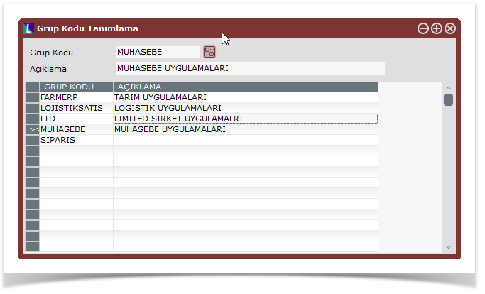

# **5\. Ekran Hakları Tanımlama**

Buradan verilen yetkiler çerçevesinde nesnelere erişebilir.

Öncesinde **NDI > Kayıt > Dizayn Hazırlama** ekranında nesneler tanımlanmış olmalıdır.

_VT Bağlantılı ya da VT Bağlantısız tanım yapılabilir. Kayıt için tab geçerlidir._

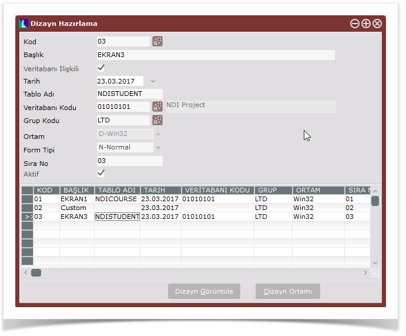

**NDI > Kayıt > Kullanıcı Hakları Tanımlama**  ile aşağıdaki ekran açılır.

# 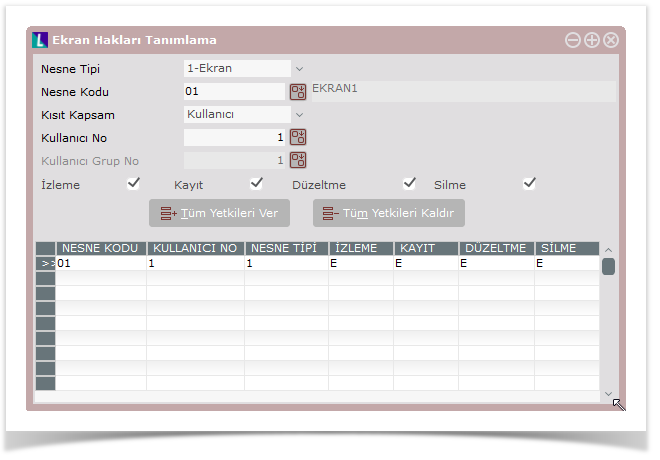

**Kullanıcı Hakları Tanımlama...**

**Nesne Tipi**

-   Ekran, Rapor ve Rehber olarak 3 tip vardır.
-   **Ekran** NDI Master molünde Kayıt menüsünde Dizayn Hazırlama menüsünden yapılan tüm NDI form neslerini demektir. (NDI > Kayıt > Dizayn Hazırlama)
-   **Rapor** ise NDI ana ekrandaki Genel menüsünden Rapor menüsü tıklanarak açılan NDI Rapor modülündeki Raporlar menüsünden İlişkisel Raporlar menüsü tıklanarak açılan ekranda tanımlanan ilişkisel rapor nesneleri demektir.
-   **Rehberler** ise NDI Master molünde Kayıt menüsünden Rehber Tanımlama menüsü tıklanarak açılan ekranda tanımlanan Rehber neseleri demektir.

**Nesne Kodu**

-   Seçilen Nesne tipine göre Nesne Kodu rehberinden ilgili nesne kodu seçilir. 

**Kısıt Kapsam, Kullanıcı No, Kullanıcı Grup No**

-   Kullanıcı, Grup ve Tüm Kullanıcılar olmak üzere 3 tip vardır. Kullanıcı seçilir ise Netsis kullanıcı rehberi aktif olur, Grup seçilir ise Kullanıcı Gruplarının rehberi açılır, Tüm kullanıcılar için bu değerler -1 olur.

**İzleme, Kayıt, Düzeltme, Silme**

-   Tasarlanan NDI ekranında kullanıcıların, kayıtları  izleme, yeni kayıt yapma, düzeltme ve silme yetkilerinin olup olmayacağının seçileceği alanlardır.

# **6\. Dizayn**

Bu bölümden önce veritabanı bağlantılarının, tablo tanımlarının ve ekran haklarının verilmiş olması gerekir.

NDI Dizayn hazırlama için temel seviyede veritabanı ve sql ile Visual Basic Scripting bilgisi gerekmektedir.

### **Dizayn Hazırlama**

İlgili dizayn için yukarıdaki bilgiler belirlendikten sonra dizayn kayıtları saklanır. Tüm ekran dizaynlarının topluca yönetilebileceği bir penceredir.

**NDI > Kayıt > Dizayn Hazırlama** ile ekran açılır.

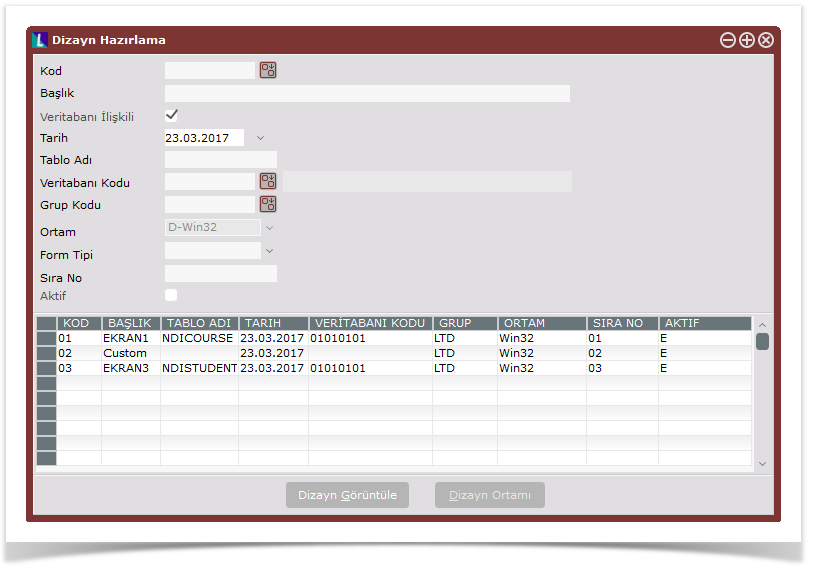

**Dizayn Ortamı**

Burada dizaynların ana bilgilerini yönetebilir ve seçili kayıt ilgili olarak dizayn ortamına geçebilirsiniz. Dizaynı form dizayn ekranında sürükle bırak ile kolayca yapabilirsiniz. Sonraki bölümde anlatılıyor.

**Dizayn Görüntüle**

Dizaynı yapılan ekranların çalışma sırasında nasıl görüneceğini test etmek için kullanılır.

**Öncesinde yapılması gereken işlemler için...**

**Database tabloları oluşturulmuş olmalı**

_NDI aracılığıyla veri giriş ekranlarının tasarlanabilmesi için öncelikle çalışılacak tabloların veri tabanında olması gerekir._

Tablolar kullanım amaçlarına göre istenilen bir veri tabanı içinde olabilir;

Örneğin temelset için açılan şirketlerin veri tabanlarında olabileceği gibi, NDI için yaratılan veri tabanında ya da tamamen farklı amaçla kullanılacak yeni bir veri tabanında bulunabilirler.

Tabloların oluşturulması, veri tabanı ve SQL bilgisi gerektirmektedir.

_İlerleyen bölümde demirbaş ve çalışan tabloları mssql server üzerinde oluşturularak anlatılmıştır._

**Dizayn Hazırlama Ekran Alanları...**

**Kod** 

-   NDI aracılığıyla yapılan her dizayn için tekrarsız bir kod verme zorunluluğu bulunmaktadır. Kendi sistematiğinize göre burada kodlamanızı yapabilirsiniz. 

**Başlık** 

-   Dizayn başlığı bilgisidir. Burada açıklayıcı bir bilgi yazmakta fayda var.
-   Bu bilgi aynı zamanda kullanım sırasında açılan ekranın başlığı olacaktır.

**Veritabanı İlişkili**

-   Burası işaretlenirse, tablo adı ve veritabanı bağlantı kodu seçilmek zorundadır.

**Tarih**

-   Dizaynın yapıldığı tarih bilgisi

**Tablo Adı** 

-   Dizayn öncesinde veritabanında SQL komutları yardımıyla oluşturulan tablonun adıdır.

**VT Kodu** 

-   Tanımlanan veri tabanı bağlantılarından hangisinin kullanılacağı, veri tabanı bağlantı kodu verilerek  belirlenecektir.

**Grup Kodu** 

-   Hazırlanan dizaynların gruplanması isteniyorsa bu sahada, ilgili dizaynın içinde yer alacağı grubu belirtebilirsiniz

**Ortam**  

-   D-Win32, Windows’ta çalışacak ekran demektir

**Form Tipi**

Tasarlanan formun N-Normal ya da C-Child olduğunun belirleneceği seçenektir.

Normal formlar açıldıkları pencereden bağımsız olup yeni bir ekran şeklinde düşünülebilir.

Child formlar ise açıldıkları pencere içinde çalışırlar.

_Temelset içinden çağrılacak NDI dizaynları **N-Normal** olarak seçilmek zorundadır._

### **NDI Dizayn Ortamı**

Form editörüdür. **Dizayn Hazırlama** penceresinden **Dizayn Ortamı** butonu ile açılır. Seçili kayıt ile ilgili bir form varsa ekrana getirir.

**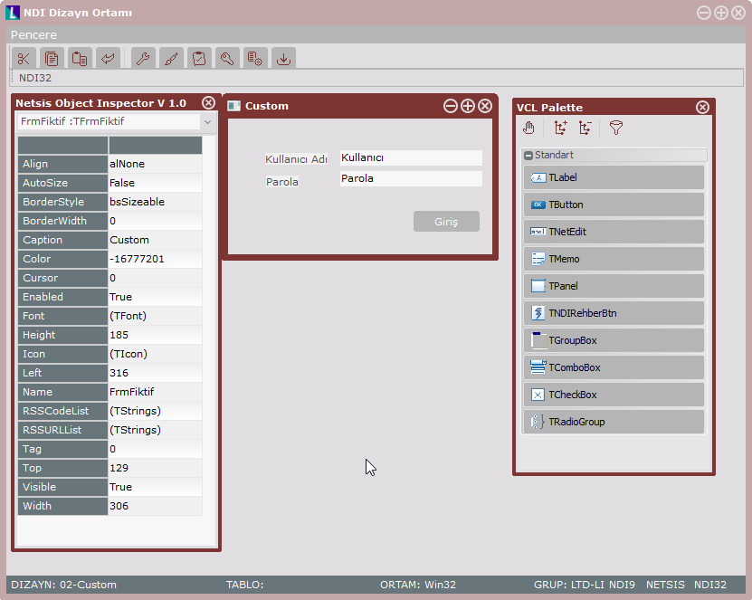**

Netsis Object Inspector,  VCL Palette araçları vardır.

**Tasarım**

-   Form üzerine ihtiyaç duyulan görsel bileşenlerin yerleştirilmesi ve görsel bileşenlere ait özelliklerin tanımlanması ile yapılır.
-   Form üzerine yerleştirilecek bileşenler, görsel bileşen kütüphanesinden seçilir ve formun istenilen yerine yerleştirilir.
-   Bileşenin seçimi için, VCL penceresine geçip istenen bileşen tıklanmalıdır. İstenen bileşen seçili iken form üzerine gelip tıklandığında, bileşenin bir kopyası form üzerinde belirecektir.
-   Form üzerinde beliren bileşen mouse ile sürükle bırak işlemi ile yerleştirilebilir.
-   Bileşen boyutları istenen şekilde mouse ile ayarlanabilir.

**VCL Palette Veri Tabanı Kontrol...**

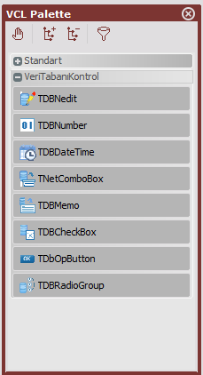 

Formun ilişkili olduğu tablonun bağlantılı çalıştığı bileşenler bu bölümde yer alır. Tablodaki alanlar buradaki bileşenler aracılığıyla **sorgulanmalı** ve **görüntülenmelidir**.

**TDBNetedit**

-   Tablodaki uzunluğu belli olan alfa nümerik tüm sahaların ekrandan sorgulanması ve gösterilmesi için kullanılır.

**TDBNumber**

-   Tablodaki nümerik sahaların ekrandan sorgulanması ve gösterilmesi için kullanılır

**TDBDateTime**

-   Tarih alanlarını, kullanıcıya takvim yardımıyla seçtirtebilmek için kullanılan bileşendir.

**TNetComboBox**

-   Birden fazla seçenekten birinin seçilebileceği saha tiplerinde tercih edilmesi gereken bileşendir.

**TDBMemo**

-   Tabloda uzun metin olarak tanımlanan sahaların sorgulanması için kullanılabilecek ekran bileşenidir. Tabloda Text ve Clob tanımlı alanlar için geçerlidir.

**TDBCheckBox**

-   Tablodaki ilgili saha evet/hayır gibi iki değerden birini alabiliyorsa, tercih edilecek en uygun bileşendir.

**TDbOpButton**

-   Tablodaki kayıtlara erişimin (ilk kayıt, son kayıt, önceki, sonraki vb.) görsel butonlar aracılığıyla yapılması isteniyorsa, her bir veri tabanı işlemi için forma bir buton konabilir. Her biri bir butona bağlanmak kaydıyla, ilk/son kayıt, önceki/sonraki kayıt, yeni kayıt, kayıt sil, kayıt sakla, benzer arama ve kesin arama fonksiyonlarını içeren bir veri tabanı gezgini tasarlanabilir

**TNetsisGrid**(NDIXGrid)

-   Ekrandaki kayıt kümesinin, belli sahalarının içeriklerinin alt alta grid (ızgara) içinde gösterilmesi için kullanılabilir. Grid bileşeni eklendikten sonra, tablodaki hangi sahaların, gridin hangi sütunlarında gösterilmesi istendiği strcolumns özelliği kullanılarak belirlenecektir.

**TNDIBlob**

-   Uzun metin, doküman, resim, clip, müzik vb. blob (binary large objects) saklamak için kullanılır. Tablodaki Image, Blob sahalarına karşılık kullanılan bileşendir. Bileşen, tablodaki tek blob sahaya eşlenmesine rağmen, kullanıcının birden fazla nesnenin saklayabilmesine olanak tanır. Kullanımda ardı ardına nesneler eklenebilir, ilk nesne, son nesne, önceki, sonraki izlenebilir, eklenen nesne silinebilir.

**TDBRadioGroup**

-   Birden çok radiobuttonları gruplayıp aynı anda bir tanesinin seçilmesini sağlayan bileşendir.

**VCL Palette Standart (DB Bağlantısız)...**

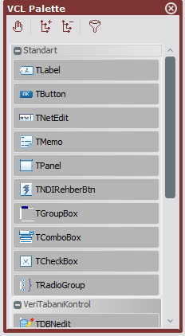

Standart bölümünde yer alan bileşenler, **veri tabanından bağımsızdır.** Dizaynın ilişkili olduğu tabloda bulunan sahalar için bu bölümdeki bileşenler kullanılmamalıdır.

**TLabel**

-   Ekranda bilgi amacıyla yazmak istediğiniz her şey için kullanabilirsiniz. Çoğunlukla saha başlıkları için kullanılır. Bunun dışında herhangi bir yerde bilgi vermek amacıyla da kullanılabilir. Bilgi girişi amacıyla kullanılmaz, görüntü amacıyla kullanılır.

**TButton**

-   Bir çok olayı başlatmak için kullanılan Tuş, Düğme, Buton bileşenir.

**TNetEdit**

-   Uzunluğu belli olan sayısal ya da alfabetik bilgilerin ekrandan sorgulanabilmesi için kullanılır.

**TMemo**

-   Uzun metin girişi için kullanılabilecek bileşendir.

**TPanel**

-   form içinde, bölümler olarak düşünülebilir. Panel’in içine bileşenler yerleştirilebilir. İsteğe göre büyütülüp, küçültülerek form üzerine bir veya birden fazla panel, bileşenlerin gruplanması amacıyla yerleştirilebilir. Panel bilgi girişi amacıyla kullanılmaz, görüntü için kullanılır

**TNDIRehberBtn**

-   Tasarlanmış Rehberleri form üzerinden çağırmak içi kullanılır.

**TGroupBox**

-   Tıpkı Panel bileşeninde olduğu gibi form içinde nesnelerin belli grup başlıklar altında görüntülenmesini sağlanamak için kullanılır.

**TComboBox**

-   Açılan liste içinde bir veya daha fazla seçeneği sunarak bir tanesinin seçilmesini sağlamak amacıyla kullanılır.

**TCheckBox**

-   Form üzerinde İşaret kutucu ile seçenekler sunup, bu seçenekleri değerlendirmek için kullanılır.

**TRadioGroup**

-   Bir yada daha fazla seçenekten sadece birini tercih ettirmek amacıyla kullanılır.
-   İleri Temel bileşenler dışında daha ileri görsel kullanım içindir. İleri bölümünde yer alan bileşenler, veri tabanından bağımsızdır.

**TPageControl**

-   Form üzerindeki bilgilerin tek pencereye sığmaması halinde, gruplanarak birden fazla sayfa üzerinde dizayn edilebilmesi için kullanılır. Page Control kullanılacak ise, öncelikle bu bileşenin yerleştirilmesi gerekir. Page Control bileşeni içine en az bir sayfa yerleştirilmelidir. Daha sonra yerleştirilen sayfalara ayrı ayrı bileşenler eklenir. Page Control içine sayfa yerleştirme işlemi, tasarım penceresinde page control bileşeni seçili iken sağ click ile gelen menü yardımıyla yapılır. Sağ click ile gelen menüde Özel İşlemler/Yeni Sayfa işlemi, bileşene yeni bir sayfa eklemeye yarar. Yine page conrol seçili iken sağ click/Özel İşlemler/Önceki/Sonraki Sayfa ise, page control içindeki sayfalar arasında ilerlemeyi sağlar ve seçili olan sayfa değişir. Bileşen yerleştirilecek olan sayfanın seçili olmasına dikkat edilmelidir.

**TScrolBox**

-   Panel ile aynı işlevi görmek üzere ekrana yerleştirilebilir. Panelin içine sığmayacak kadar çok bilgi yerleştirilecek ise, scrollbox tercih edilebilir. Bu kutucuğun içinde yukarı, aşağı, sola, sağa scroll (kaydırma) yapılarak daha fazla bilgi yerleştirilebilir.

**TBevel**

-   Formun üzerinde çizgi çekmek, kutu benzeri görüntüleri oluşturabilmek için görüntü amacıyla kullanılır.

**TNDIPicture**

-   Form üzerine resim koyabilmek için kullanılır.

**TAnimate**

-   Video clip vb. bir animasyonun form üzerinde gösterilmesi için kullanılır.

**Varsayılan Değer Tanımlama**

**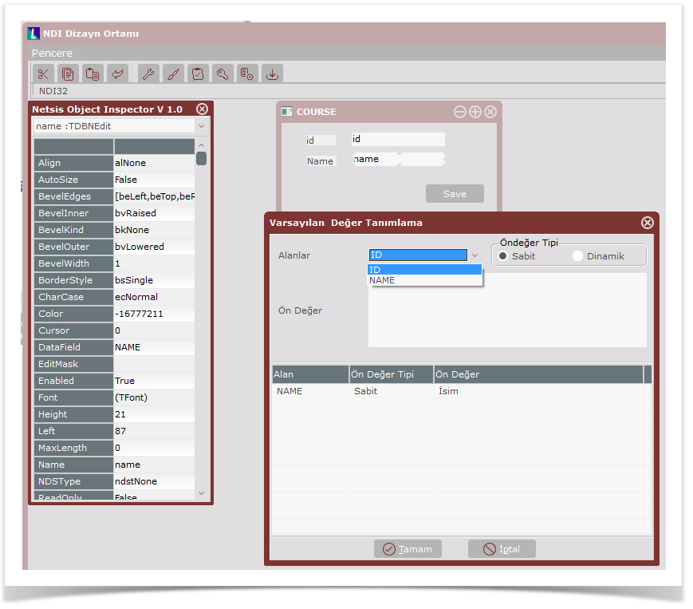**

İstenen bileşenlere kullanım sırasında varsayılan değerler atamak mümkündür. Form açıldığında, ya da veri tabanı bağlantılı formda, yeni kayıt durumuna geçildiğinde, burada tanımlanan varsayılan (öndeğer, default) değerler gelecektir. 

_Öndeğer Tipi  Sabit bir öndeğer belirtilebileceği gibi, dinamik anlık oluşan bir öndeğer de belirlenebilmektedir._ 

Öndeğer Sabit öndeğer ya da dinamik oluşturulmak istenen öndeğer için sql cümlesi yazılarak belirlenir. Örnek select **getdate**() cümlesi ile tarih sahasına günün tarihi öndeğer olarak getirilebilir. 

Ön Değer Sil  Tanımlanan öndeğerler pencerenin alt bölümündeki gridde görülebilmektedir. İstenmeyen kayıtlar seçilerek sağ click’te gelen Ön Değer Sil seçeneği ile silinebilir.

# **7\. Rehber Hazırlama**

Rehber, Veri tabanında mevcut belli bilgileri hızlı bir şekilde listeleme, sıralama, arama yapma gibi olanakları sağlayan görsel bileşendir.

Netsis ürününde ekranlar genelde

-   bilgi alanı (form) ve
-   **rehber**den (grid)

oluşur.

İstenen kaydın bulunması ve seçilen kaydın bilgi alanına döndürülmesi otomatik olarak sağlanır.

**NDI > Kayıt > Rehber Tanımlama** ile ekran açılır. Rehber Tanımlama seçeneği ile, NDI tasarımlarında kullanılacak olan her çeşit rehber tanımlanabilir, topluca izlenebilir ve yönetilebilir.

Bu bölümde tanımlanan bir rehber, aynı amaca hizmet eden birçok tasarımda ve bir tasarım içinde birden fazla kez kullanılabilir.

Rehberin tasarıma eklenmesi için Rehber tuşu kullanılmalıdır.

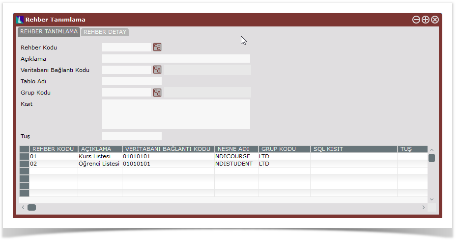

**Rehber Tanımlama Alanları...**

**Rehber Kodu**

-   Tanımlanan her rehber için serbest ve tekrarsız bir kod belirlenmelidir.
-   Kendi sistematiğinize göre burada kodlamanızı yapabilirsiniz.
-   Belirlenen kod dizayn ortamında tasarıma eklenen rehber tuşunun rehber kodu özelliğinde belirtilecektir.

**Açıklama**

-   Tanımlanan rehbere ait açıklama bilgisi girilecek alandır.
-   Hatırlatma amacıyla, rehberin içeriği ve kullanım amacı ile ilgili bilgi yazılmasında fayda var. 

**VT Bağlantı Kodu**

-   DB bağlantı tanımla bölümünde anlatılan veri tabanı bağlantılarından hangisinin kullanılacağı, sahanın rehberi aracılığıyla seçilerek belirlenebilir.

**Tablo Adı**

-   Rehber ile ilişkili olan, arama yapılacak ve görüntülenecek tablo ya da view veri tabanındaki fiziksel adıdır.
-   Tablo ya da view’un dizayn öncesinde, veritabanında olması gerekmektedir.

**Grup Kodu**

-   Hazırlanan rehberlerin gruplanması isteniyorsa bu alana, ilgili rehberin içinde yer alacağı grubu belirtebilirsiniz.
-   Kendi sistematiğinize uygun gruplandırmayı yapabilirisiniz.
-   Herhangi bir grup kodu verilmezse, NDI, rehberi GENELREHBER grubu altına alacaktır.

**Kısıt**

-   Rehberin düzenlendiği tablodaki herhangi bir alana kısıt verilerek
-   Rehberde gelen kayıt kümesinin daraltılması sağlanabilir.
-   Kısıt cümlesi, SQL cümlelerinin WHERE ile başlayan kısıt bölümünde yazılan formatta olmalıdır.   

**Tuş**

-   Rehber kısa yol tuşudur.
-   Kullanımda, ctrl ile birlikte bu tuşa basıldığında, rehber aktif hale gelir.

**Rehber Detay**

Rehber ana tanımları tamamlandıktan sonra ve rehber tanımı ekranda seçiliyken, aynı ekrandaki ikinci sayfaya (Rehber Detay sayfasına) geçilerek rehber alanlarının (sütun) tek tek tanımları yapılabilir.

Rehber Detayları tanımlanan rehberin kodu ve açıklaması bilgi olarak gösterilmektedir.

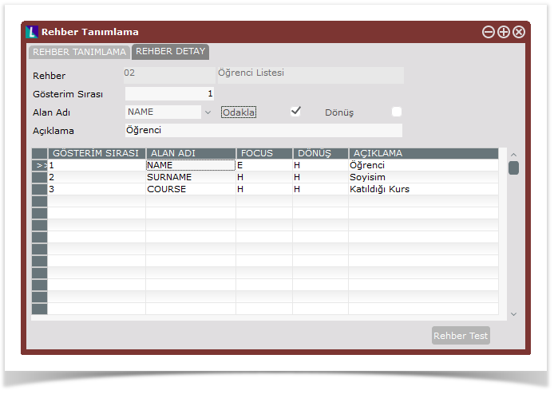

**Rehber Detay Alanları...**

**Gösterim Sırası**

-    Tanımlanacak alanın (saha,sütun) rehberde kaçıncı sırada getirileceğinin bilgisidir. 

**Alan Adı**

-   Rehbere getirilecek olan alanın (saha, sütun) tablodaki saha ismi karşılığıdır. 

**Açıklama**

-   Rehbere getirilecek olan sahanın rehber sütun başlığıdır. 

**Focus**

-   Rehber açıldığında arama amaçlı üzerinde durulacak olan sahanın hangisi olacağının belirlendiği bilgidir.
-   Örneğin kod ve isim bilgilerinden oluşan bir rehberde, ilk saha kod ve ikinci saha isim olarak tanımlanmış olabilir.
-   Ancak sıklıkla isimden arama yapılacağı düşünüldüğünden rehber ilk açıldığında cursor’ın isim sahası üzerinde durması istenebilir.
-   Rehber için tanımlanan sahalardan sadece bir tanesinin Focus özelliği işaretlenebilmektedir. 

**Dönüş**

-   Rehber kullanılıp, arama sonucu bir kayıt tespit edildikten sonra, rehberden uygulamaya döndürülmesi istenen sahanın hangisi olduğunun belirlendiği bilgidir.
-   Örneğin kod ve isim bilgilerinden oluşan bir rehberde kod bilgisi uygulamaya döndürülmek istenecektir.
-   Rehber için tanımlanan sahalardan sadece bir tanesinin Return özelliği işaretlenebilmektedir. 

**Rehber Test**

-   Tanımlanan rehberin çalışmasını test etmek amacıyla bu buton kullanılabilir.

### Rehber Test

-   Uygulamanın kullanımı sırasında rehber tuşuna tıklandığında ya da rehberin kısa yol tuşu ile rehber açılır. 
-   Tanımlamada belirtilen focus alanı aktif olarak gelir.
-   Rehber penceresinde, hangi sahadan arama yapmak isteniyorsa, mouse ile ekranın solundaki panelde yer alan saha isimlerin altındaki kutucuk tıklanır, tab tuşu yada shift tab tuşu kullanılarakta sahalarda ileri geri gezinti yapılır.
-   Bilgi giriş sahasına aranmak istenen karakterler yazılır ve alan adının yanındaki sıralama ve/veya kısıt tuşları tıklanarak rehberin kayıtları listelemsi sağlanır.
-   Rehberde ekran kapatılmadan önce en son hangi sıralama ve kısıt tuşları kullanıldı ise aynı rehber tekrar açıldığında ekrana yine aynı tuşlar seçili olarak gelmektedir.
-   Rehberlerin boyutları kullanıcılar tarafından rehberin köşelerinden çekilerek büyültülebilir yada küçültülebilir.

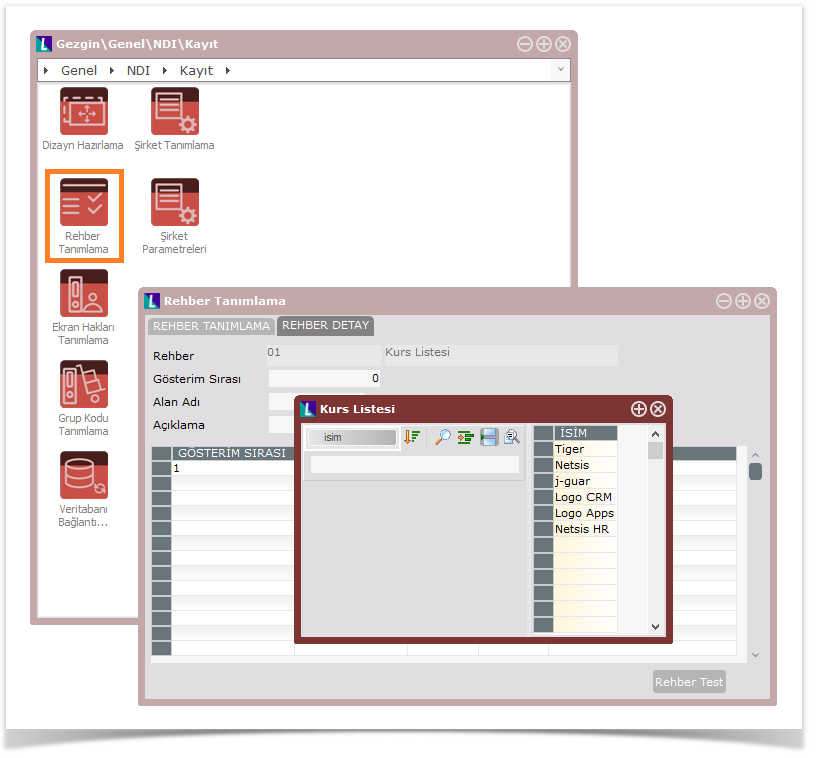

**Rehberde Sıralama Tuşları...**

Rehberde sıralama tuşları ile aranmak istenen kayıtlar artan, azalan sırada  yada sıralama yapılmadan listelenebilmektedir. Sıralama tuşlarında, bir tuştan diğerine klavye ile geçmek için Alt tuşu ile beraber aşağı veya yukarı ok   tuşları kullanılmalıdır. Fare ile sıralama tuşları değiştirilmek istendiğinde, ilgili tuş fare bir kez tıklatıldığında diğer sıralama seçeneğine geçilebilecektir. Her bir farklı sıralama tuşuna basıldıkça sıralama yaptırılan kolonun rengi değişmektedir.

**Artan**

Rehberde listelenecek  bilgilerin artan sırada yani küçükten büyüğe doğru sıralanmasını sağlayan tuştur.

**Azalan**

Rehberde listelenecek bilgilerin azalan sırada yani büyükten küçüğe doğru sıralanmasını sağlayan tuştur.

**Sıralama**

Rehber ilk açıldığı zaman programın belirlemiş olduğu standart bir alana göre sıralı olarak gelmektedir.

Rehberdeki listelenecek alanların belirtilen bir alana göre Artan yada Azalan sırada değil, rehberin standart sıralamasına göre ekrana ilk geldiği şekliyle izlenmesi istendiğinde kullanılması gereken tuştur.

Örneğin stok rehberi ilk açıldığında stok adına  göre sıralı gelmektedir. Rehberde stok koduna göre azalan sıraya göre sıralama yapıldıktan sonra, sıralama yapılmak istenmediğinde bu tuş tıklatılırsa rehberdeki veriler stok adına  göre sıralı gelecektir.

**Rehberde Kısıt Tuşları...**

Rehberde kısıt tuşları ile listelenecek kayıtlar için kısıt verilebilmekte, verilen kısıta uyan kayıtların rehberde listelenmesi sağlanabilmektedir. Kısıt tuşlarında, bir tuştan diğerine klavye ile geçmek için Alt tuşu ile beraber sağ ya da sol ok tuşları kullanılmalıdır. Fare ile kısıt tuşları değiştirilmek istendiğinde, seçilmek istenilen tuşun üzerine gelinip fare bir kez tıklatılması gerekmektedir.

**Eşit**

Rehberde veri girişi yapılan alanda yazılan değere eşit olan kayıtların listelenmesini sağlayan tuştur. Yani rehberdeki kayıtlar eğer bu alanda verilen kısıdı birebir karşılıyorsa listelenecektir.

Örneğin grup kodu alanında ” Eşit” kısıdı seçilip değer olarak “01” yazıldığı zaman rehbere sadece grup kodu 01 olan kayıtlar gelecektir.

 ** İle Başlayan**

Rehberde veri girişi yapılan alanda yazılan değer ile başlayan kayıtların listelenmesini sağlayan tuştur. Örneğin stok kodu alanında “İle Başlayan “ kısıdı seçilip değer olarak “01” yazıldığı zaman rehbere stok kodu 01 ile başlayan kayıtlar gelecektir. 01204-AB, 01AC-200, 01 vb.

**İle Başlayan Ve Sonrası**

Bu seçenek seçildiği zaman, öncelikle  rehberde veri girişi yapılan alanda yazılan değer ile başlayan kayıtlar, daha sonra diğer kayıtların  tamamı listelenecektir.

Örneğin stok kodu alanında “İle Başlayan Ve Sonrası” kısıtı seçilip değer olarak “01” yazıldığı zaman öncelikle stok kodu “01” ile başlayan stoklar, arkasından da diğer stokların tamamı listelenecektir.

01,01204-AB, 01AC-200, 02, 03, 04,05 vb.

İçinde Geçen (F8)

 İçinde rehberde veri girişi yapılan alanda yazılan değer geçen kayıtların listelenmesini sağlayan tuştur.

Örneğin stok kodu alanında “İçinde Geçen ” kısıdı seçilip değer olarak “01 ” yazıldığı zaman,stok kodunun herhangi bir yerinde başında, sonunda yada ortasında “01” geçen kayıtlar rehberde listelenecektir.

T001, P101, 01204-AB, B01CM vb. “İçinde Geçen” kısıtının işlevi  “F8” tuşu kullanılarak ta uygulanabilmektedir.

# **8\. Temelset içerisinden NDI çağırma**

NDI paketinde hazırlanan ekranların Temelset (Ticari) ve Personel (İK) paketinde bulunan modüllerdeki menülere eklenebilmesi ve bu modüllerden çalıştırılabilmesi mümkündür.

NDI paketinde hazırlanan rehberlerin, Temelset ve Personel paketlerinde hazırlanan **ek rehberler** mantığıyla kullanılabililir.

Ayrıca, NDI paketinde hazırlanarak Temelset ve Personel paketine eklenen ekranlar için kolon bazı **_geçerlilik ve özellikler_** kullanılabilir.

## **NDI bağlantı tanımları**

NDI paketinde hazırlanan ekran ve rehberlerin kullanılacağı şubeler için;

-   **Şirket/Şube/Parametre Tanımlarına**  “NDI Uygulaması Var” parametresinin işaretlenmesi gerekmektedir.

_Bunun için **Netsis TemelSet'ten** Genel > Yardımcı Programlar > Kayıt **Şirket/Şube/Parametre Tanımlarına** çalıştırınız._

NDI Uygulaması Var işareti sonrası **NETSİS TemelSet'**i tekrar çalıştırmak gerekebilir.

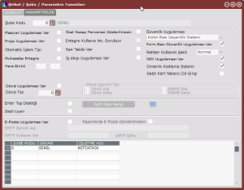

“NDI Uygulaması Var” parametresi işaretlendiğinde **Yardımcı Programlar/Kayıt/NDI menüsü** altında aktif hale gelecektir.

Şube ile NDI veri tabanı bağlantısının kurulacaktır. NDI paketinde tanımlanan ekran ve rehberlerin ilgili şubede kullanılmasına yönelik tanımlamalar yapılabilir.

 Burada yapılan tanımlamalar ile, temelset paketindeki şubelerden hangi NDI şirketine,hangi kullanıcı ile bağlanılacağı belirlenmektedir

**Netsis TemelSet**'ten Genel>Yardımcı Programlar>Kayıt>NDI  **NDI Bağlantı Tanımlamaları** çalıştırınız.

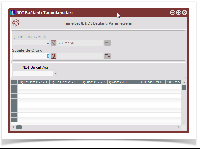

**NDI Bağlantı Tanımlamaları...**

**İşletmelerde Ortak**

-   Tanımlanan bağlantının hangi işletme(ler) için geçerli olduğunun belirlendiği alandır. Temelset-NDI bağlantısının tüm işletmelerde geçerli olması isteniyorsa bu sahaya -1, sadece belirli bir işletmede geçerli olması isteniyor ise de ilgili işletmenin kodu girilmelidir. Bu saha sadece Fusion paketinde bulunan merkez işletmede iken aktif olacaktır. Bağlantı tanımlaması, merkez işletmede yapılmıyor ise, işletme kodu sahası pasif olacak ve içinde bulunulan işletme kodu program tarafından getirilecektir.

**Şubelerde Ortak**

-    Tanımlanan bağlantının hangi şube(ler) için geçerli olduğunun belirlendiği alandır. Temelset-NDI bağlantısının tüm şubelerde geçerli olması isteniyorsa bu sahaya -1, sadece belirli bir şubede geçerli olması isteniyor ise de ilgili şubenin kodu girilmelidir. Bu saha sadece merkez şubede iken aktif olacaktır. Bağlantı tanımlaması, merkez şubede yapılmıyor ise, şube kodu sahası pasif olacak ve içinde bulunulan şube kodu, program tarafından getirilecektir.

**NDI Şirket Adı**

-   Bağlantı kurulacak NDI şirketinin belirlendiği sahadır. Sahanın sağ tarafında bulunan aşağı ok işaretine basıldığında NDI paketinde tanımlı şirketlerin isimleri listelenecektir. Yukarıda açıklanan İşletmelerde Ortak ve Şubelerde Ortak sahaları kullanılarak, birden fazla işletme ve şubenin tek bir NDI şirketi ile bağlantısını sağlamak mümkündür. 

**Ortak Bağlantı**

-   Netsis 7 ve sonrası versiyonunda NDI bağlantısı ortak bağlantı ile yapılır. Önceki versiyonlarda seçeneklidir. NDI ile tasarlanmış uygulamaların kullanımının, genel bir kullanıcı ile gerçekleşmesi isteniyorsa işaretlenmesi gereken seçenektir. Ortak Bağlantı seçeneğinin işaretlenmesi halinde (Ananymous Access), NDI paketine bağlantı, Temelset paketine bağlanan kullanıcılar yerine, bu bölümde verilecek olan kullanıcı ve şifre ile yapılacaktır. Bu durumda NDI tarafında, burada belirlenen kullanıcı isim ve şifresinin tanımlı olması yeterli olacaktır. Ortak Bağlantı seçeneğinin işaretlenmediği durumlarda ise (Integrated Netsis Authentication), kullanıcının NDI şirketinde tasarım yapabilmesi ve tasarımları kullanabilmesi için, Temelset şirketine giriş yaptığı kullanıcı adı ve şifresi geçerlidir. Dolayısıyla, Ortak Bağlantının işaretli olmadığı durumlarda, NDI şirketine bağlanacak tüm kullanıcıların ve şifrelerinin, NDI şirketinde tanımlanmış olması gerekmektedir.

## **Nesnelerin standart modüllere eklenmesi**

Netsis **TemelSet**'ten **_Genel > Yardımcı Programlar > Kayıt > NDI_** _"NDI Nesneleri" ile çalıştırılır._

NDI paketinde hazırlanan ekran ve rehberlerin listelenir. Bu nesneler temelset  modüllerine eklenebilir.

-   Bu menünün aktif olması için **TemelSet'**te Yardımcı Programlar/"**Şirket/Şube/Parametre Tanımları**" bölümünden “NDI Uygulaması Var” parametresinin işaretlenmiş olması gerekmektedir.
-   NDI paketinde tanımlanan ekran ve rehberlerin bu listede görüntülenmesi ve temelset paketine eklenebilmesi için;
    -   **Paket** ve Hesaplanacak seçeneklerinin işaretlenmelidir. (NDI Uygulamasından Genel > NDI > Kayıt _**"Veritabanı Bağlantı Tanımlama"**_ ile açınız)
-   NDI'da ekran tanımlaması yapılırken form tipi olarak Normal seçilmesi gerekmektedir. Child olarak tanımlanan ekranlar temelset paketine eklenemez.
    -   İlgili parametreler NDI Genel>NDI>Kayıt **Dizayn Kayıt** ekranından değiştirilebilir.
-   Bağlantı tanımlanmamış NDI şirketinde oluşturulan nesneler, bu bölümden temelset menüsüne eklenebilmesine rağmen, menüde görülemeyecektir.
    -   Nesnelerin tanımlı olduğu NDI şirketi için mutlaka NDI-temelset bağlantı tanımlaması yapılmalıdır.

**Temelset içinden kullanılacak her bir NDI nesnesi, bu bölümde mutlaka tanımlanmalıdır.**

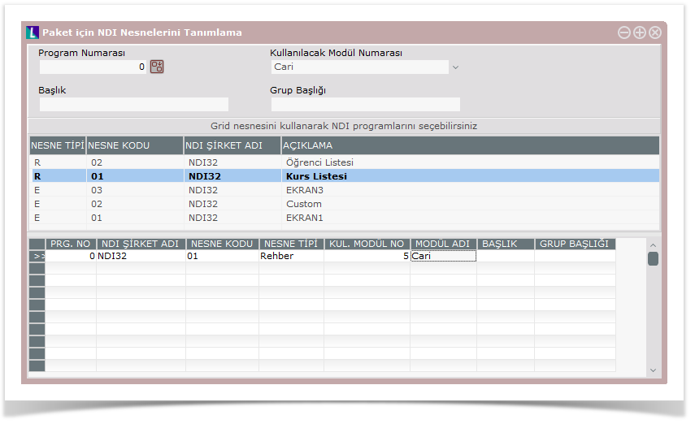

 

**Program Numarası**

-   Temelsete eklenen her bir NDI nesnesine tekrarsız serbest bir numara verilmelidir. Verilen bu program numaraları daha sonra kullanıcı işlemleri modülünde, kullanıcılara nesne ile ilgili hakların belirlenmesi sırasında gerekecektir. NDI paketinde tanımlanan nesne ve rehberler, temelset paketine eklendikten sonra, Admin yetkisine sahip olmayan kullanıcılar için, bu nesnelere ait hak tanımlaması yapılacaktır. Dolayısıyla, temelset paketinde bulunan, Kullanıcı İşlemleri/Kullanıcı Program Yetkileri tanımlama bölümünde, NDI Uygulamaları başlıklı modül altında (5000 numaralı modül), bu nesnelerin belirli bir program numarası ile listelenmesi gerekmektedir.

**Kullanılacak Modül Numarası**

-   NDI paketinde tanımlanan ekranların, hangi temelset modülünde kullanılacağının belirlendiği sahadır. İlgili ekranın bütün modüllerde kullanılması isteniyorsa Tüm Modüller, sadece belirli bir modülde kullanılması isteniyorsa da, ilgili modül seçilmelidir. NDI’da tanımlanan rehberlerin temelset paketine eklenmesi aşamasında, burada seçilen Kullanılacak Modül Numarası bilgisinin herhangi bir geçerliliği yoktur. Rehberler, temelset paketi içinden hazırlanan diğer ek rehberler gibi tüm modüllerde kullanılabilecektir.

**Başlık**

-   Eklenen ekran ve rehberlerin başlık bilgisi olup, Kullanıcı İşlemleri/Kullanıcı Program Yetkileri tanımlama bölümünde, bu sahada belirlenen isimleri ile listeleneceklerdir. Ayrıca, tanımlı ekranların Temelset modüllerine eklenmesi halinde, ekranlar için bu sahada girilen başlık bilgileri, modül ana menüsüne gelecek olan NDI Uygulamaları menü başlığı altında listelenecektir.

Modül ana menüsüne eklenen ekranın, menüde bir alt başlık altında listelenmesi isteniyorsa kullanılacak sahadır. Nesne, ilgili modüldeki NDI Uygulamaları menüsünde, tanımlamada verilen grup başlığı altında listelenecektir.

**Grid ile NDI Nesneleri Seçimi**

Bu listede bulunan nesneler, Nesne Tipleri bazında sıralanmaktadır.

Nesne Tipi sütununda

-   E : Ekran
-   R : rehber

Nesnenin seçimi için, nesne üzerinde farenin sol tuşuna iki kez tıklamak yeterlidir. Bu durumda aşağıdaki onaylama ekranı gelecektir.

Eklenen nesnelerde değişiklik yapmak için tanımlama ekranın alttaki gridten kayda çift tıklayın. Değişikliği yaptıktan sonra kaydedin.

Eklenen nesneleri temelset paketinden çıkarmak için çıkarılması istenen nesneye ait tanımlama seçildikten sonra  F7 kısayol/ Kayıt sil tuşuna basın.

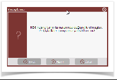

# **9\. import/export**

**Export**

-   NDI uygulamasında hazırlanan bir dizayn ya da rehberin dış ortama XML formatında aktarılması

**Import**

-   Bir dizayn ya da rehberin XML formatında uygulama içerisine aktarılması
-   NDI uygulaması tarafından XML dosyaya export edilmiş bir dizayn ya da rehberin, başka bir NDI uygulamasına yüklenmesi için kullanılır.

NDI uygulamasından Genel > NDI > İşlemler > **XML Dışarı Aktar - İçeri Yükle** çalıştırılır.

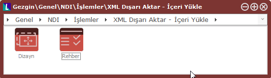

Dizayn için aşağıdaki ekran gelir.

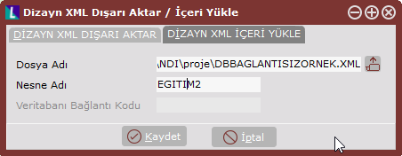

Dizayn oluşturma detay bilgi için [tıklayınız](ndi-dizayn-tasarimi.md)...

Kaydet

Kaydet

Kaydet

Kaydet

Kaydet

Kaydet

Kaydet

Kaydet

Kaydet

Kaydet

Kaydet

Kaydet

Kaydet

Kaydet

Kaydet

Kaydet

Kaydet

Kaydet

Kaydet

Kaydet

Kaydet

Kaydet

Kaydet

Kaydet

Kaydet

Kaydet

Kaydet

Kaydet
