> Bu sayfa Logo DYS "Netsis Uyarlama Araçları" dokümantasyonunun bir kopyasıdır. İçerik Logo Yazılım'a aittir. Kaynak: [NDI Dizayn Tasarımı](https://dys.logo.cloud/external?cid=2c59cd48-0ac7-49a5-8fc7-26504c38020e&link=02669525-0b5e-43c3-aa22-28e072661079&tenantId=cdd87e13-3009-4dd1-a5b8-2a005c0e58da&hideName=True&locale=tr_TR)

# NDI Dizayn Tasarımı

# 1\. NDI Dizayn Hazırlama

  

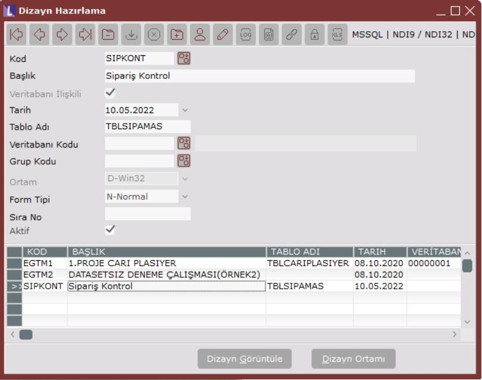

Dizayn Hazırlama seçeneği ile, NDI aracılığıyla hazırlanan tüm ekran dizaynlarının topluca izlenebileceği pencere açılacaktır. Burada dizaynların ana bilgilerini yönetebilir ve seçili dizaynla ilgili olarak dizayn ortamına geçebilirsiniz.

  

Dizaynların yönetimini ve dizayn ortamında yapılabilecekleri anlatmadan önce şunlara dikkat etmek gerekir. NDI uygulamasında dizayn hazırlamak, görsel bir programlama aracı ile program yazmaktan farklı değildir. Örneğin Visual Basic ile program yazmaya benzer. O nedenle NDI kullanacak kişilerin programlama mantığı ve görsel programlama aracıyla program yazma deneyimi bulunması gerekmektedir. NDI uygulamasında ve bu dokümandaki birçok deyim programlama jargonu olup açıklamaları programlama bilgisi olmadığı durumda anlaşılamayabilir. 

**Kod**

NDI aracılığıyla yapılan her dizayn için tekrarsız bir kod verme zorunluluğu bulunmaktadır. Kendi sistematiğinize göre burada kodlamanızı yapabilirsiniz.

  

**Başlık**

Dizayn başlığı bilgisidir. Burada açıklayıcı bir bilgi yazmakta fayda var. Bu bilgi aynı zamanda kullanım sırasında açılan ekranın başlığı olacaktır.

  

**Veritabanı İlişkili**

Burası işaretlenirse, tablo adı ve veritabanı bağlantı kodu seçilmek zorundadır.

  

**Tablo Adı**

Dizayn ile ilişkili olan, veri girişi yapılacak olan tablonun veri tabanındaki adıdır. Tablonun dizayn öncesinde, veritabanında SQL komutları yardımıyla yaratılmış olması gerekmektedir. NDI, tablo yaratma işlevini içermez.

  

**Tarih**

Dizaynın yapıldığı ilk tarih bilgisi olarak saklanabilecek alandır.

  

**DB Kodu**

NDI ile birden fazla veri tabanında bulunan tablolar için dizayn yapılabilmektedir. Örneğin, hem Temelset hem de Personel veri tabanlarına ait dizaynlar yapılabilmektedir. Veri tabanı bağlantıları dokümanın ilerleyen bölümlerinde anlatılacak olan başka bir menü seçeneğinden yapılmaktadır. _Bknz: DB Bağlantı Tanımlama._ Her bir veri tabanı bağlantısı tanımına bir kod verilecektir. Bu sahada ise, tanımlanan veritabanı bağlantılarından hangisinin kullanılacağı, veri tabanı bağlantı kodu verilerek  belirlenecektir. Tanımlı veri tabanı bağlantıları, sahanın rehberi aracılığıyla da belirlenebilir.

  

**Grup Kodu**

Hazırlanan dizaynların gruplanması isteniyorsa bu sahada, ilgili dizaynın içinde yer alacağı grubu belirtebilirsiniz. Kendi sistematiğinize göre gruplandırmayı yapabilirsiniz. Herhangi bir grup kodu verilmezse, NDI, dizaynı GENELDIZAYN grubu altına alacaktır.

  

**Ortam**

NDI dizaynlarda, birden fazla ortamı desteklemektedir. Dizayn, D-Win32, W-WML, H-HTML, ya da P-Pocket Pc ortamlarında çalıştırılmak üzere hazırlanabilir. Ancak her bir dizayn sadece bir ortamda çalışabilmektedir. Dizayn için ortam belirlenip dizayn saklandıktan sonra ortam değişikliği yapmak mümkün değildir. Win-32, Windows ortamında çalışacak ekran, HTML ise internet browser’da çalışacak ekran anlamına gelir. WML- Wap için, Pocket PC de PDA’ler için ekran olup, mevcut versiyonda desteklenmemektedir. Bu ortamlar, ileri versiyonlarda desteklenecektir.

  

**Form Tipi**

Tasarlanan formun N-Normal ya da C-Child olduğunun belirleneceği seçenektir. Normal formlar açıldıkları pencereden bağımsız olup yeni bir ekran şeklinde düşünülebilir. Child formlar ise açıldıkları pencere içinde çalışırlar. Örneğin Stok modülü ana menüsü normal formdur, bu modülün içinde açılan stok kartı kayıtları ekranı ise child formdur. Stok modülü bir task olarak görünür ve geçiş yapılabilir, ancak stok kartı kayıtları, stok modülünden ayrı bir task olarak görünmez.

  

İlgili dizayn için yukarıdaki bilgiler belirlendikten sonra dizayn saklanır. Dizaynı hazırlamak için ise, seçili dizayn için ekranın sağ alt köşesinde bulunan _Dizayn Ortamı_ butonuna basmak gerekir.

## **1\. Dizayn Ortamı**

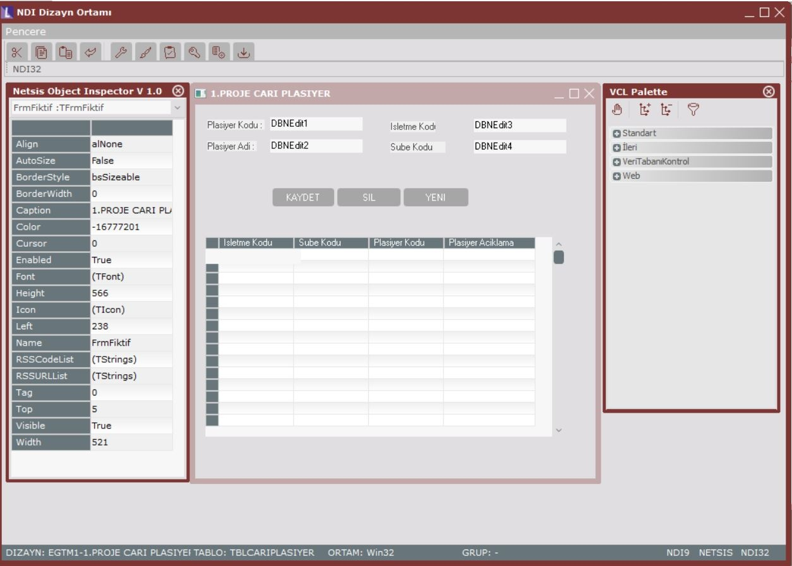

NDI Dizayn Ortamında ana menü, araç çubukları, Netsis Object Inspector, Tasarım ve VCL bölümleri bulunmaktadır.

  

**Dizayn Ortamı Ana Menüsü**

Dizayn ortamında ana menüde bir tek Pencere seçeneği bulunmaktadır. Pencere menüsü, her menüde olduğu gibi, mevcut pencerelerin seçilmesine, yerleştirilmesine vb. yönetilmesine yöneliktir.

### 1.1  Dizayn Ortamı Araç Çubukları

Araç çubuklarının kullanımı tüm diğer modüllerin araç çubuklarında olduğu gibidir.

  

**Kes, Kopyala, Yapıştır, Geri Al;** Windows uygulamalarındaki standart kullanım şekli ile aynıdır.

  

**Object Inspector;** Object Inspector penceresine geçişi ve seçili olmasını sağlar.

  

**Tasarım;** Tasarım penceresine geçişi ve seçili olmasını sağlar.

  

 **VCL;** VCL (Visual Component Library) penceresine geçişi ve seçili olmasını sağlar.

  

 **Anahtar Alan Göster;** Anahtar alan seçimi penceresini açar. Anahtar alan seçimi işlemi tasarım işleminde anlatılacaktır.

  

 **Default Değer Göster;** Varsayılan (Öndeğer) Değer tanımlama penceresini açar. Varsayılan Değer tanımları tasarım işleminde anlatılacaktır.

  

 **Dizayn Kaydet;** Yapılan değişiklikleri kaydetmeye yarar. F2 kısayol tuşu da aynı işleve sahiptir.

### 1.1.1.  Tasarım Araçları

NDI Dizayn Ortamında, tasarımın kendisi (form, ekranın ortasında) ve yardımcı araçlar olarak VCL (Visual Component Library – Görsel Bileşen Kütüphanesi, ekranın sağ tarafında) ve Object Inspector (Nesne Denetçisi, ekranın sol tarafında) bulunmaktadır.

**Form Üzerine Bileşen Yerleştirme**

Tasarım, form üzerine ihtiyaç duyulan görsel bileşenlerin yerleştirilmesi ve görsel bileşenlere ait özelliklerin tanımlanması ile yapılır. Form üzerine yerleştirilecek bileşenler, görsel bileşen kütüphanesinden seçilir ve formun istenilen yerine yerleştirilir. Bileşenin seçimi için, VCL penceresine geçip istenen bileşen tıklanmalıdır. İstenen bileşen seçili iken form üzerine gelip tıklandığında, bileşenin bir kopyası form üzerinde belirecektir. Form üzerinde beliren bileşen mouse ile sürükle bırak işlemi ile yerleştirilebilir. Bileşen boyutları istenen şekilde mouse ile ayarlanabilir.

  

**Bileşen Özellikleri Belirleme**

Bileşen form üzerine yerleştirildikten sonra ve seçili iken, nesne denetçisi penceresine geçip, özellikleri belirlenebilir.

### 1.1.1.1. VCL (Visual Component Library – Görsel Bileşen Kütüphanesi)

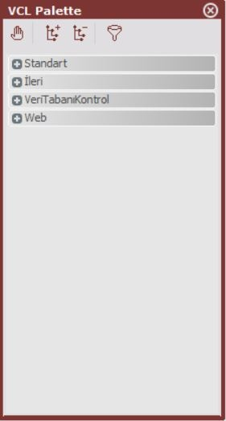

NDI uygulamasında, bir form üzerine yerleştirilebilecek mevcut bileşenleri içeren araçtır. Form üzerindeyken VCL’e geçiş mouse yardımıyla ya da F10 kısa yol tuşuyla yapılabilir.

VCL’de mevcut görsel bileşenler şunlardır;

(Şekillerde her bileşenin VCL’deki ikonları ile form üzerinde konduğu zaman oluşan görüntüsü verilmiştir).

  

### 1.1.1.1.1 **Standart Bileşenler**

Standart bölümünde yer alan bileşenler, veri tabanından bağımsızdır. Dizaynın ilişkili olduğu tabloda bulunan sahalar için bu bölümdeki bileşenler kullanılmamalıdır.

  

**Rehber Tuşu (TNDIRehberBtn)**

Rehber bileşenini form üzerine yerleştirmek için kullanılır. Rehber tuşuna bağlanacak rehber için tanım ayrıca yapılmalıdır. _Bknz: Rehber Tanımları._

  

**Panel (TPanel)**

Panel bileşeni, form içinde, form bölümü olarak düşünülebilir. Panel’in içine bileşenler yerleştirilebilir. İsteğe göre büyütülüp, küçültülerek form üzerine bir veya birden fazla panel, bileşenlerin gruplanması amacıyla yerleştirilebilir. Panel bilgi girişi amacıyla kullanılmaz, görüntü için kullanılır.

  

**Memo (TMemo)**

Uzun metin girişi için kullanılabilecek bileşendir.

  

**NetEdit (TNetEdit)**

Uzunluğu belli olan sayısal ya da alfabetik bilgilerin ekrandan sorgulanabilmesi için kullanılır.

**Tuş (TButton)**

Ekrana buton koyabilmek amacıyla kullanılır. Buton tıklandığında mutlaka bir işlem yapılması gerekmektedir. Aksi halde buton koymanın bir anlamı olmayacaktır. Buton basıldığında yapılması istenen işlemler _script girişi_ aracılığıyla yapılabilir. Script girişi dokümanın ilerleyen bölümlerinde anlatılacaktır.

**Etiket (TLabel)**

Ekranda bilgi amacıyla yazmak istediğiniz her şey için kullanabilirsiniz. Çoğunlukla saha başlıkları için kullanılır. Bunun dışında herhangi bir yerde bilgi vermek amacıyla da kullanılabilir. Bilgi girişi amacıyla kullanılmaz, görüntü amacıyla kullanılır.

  

### 1.1.1.1.2 **İleri Bileşenler**

Temel bileşenler dışında daha ileri görsel kullanım içindir. İleri bölümünde yer alan bileşenler, veri tabanından bağımsızdır.

  

**Animasyon (TAnimate)**

Video clip vb. bir animasyonun form üzerinde gösterilmesi için kullanılır. Bilgi girişi amacıyla kullanılmaz, görüntü amacıyla kullanılır.

  

**Resim (TNDIPicture)**

Form üzerine bir resim koyabilmek için kullanılır. Bilgi girişi amacıyla kullanılmaz, görüntü amacıyla kullanılır.

  

**Bevel (TBevel)**

Formun üzerinde çizgi çekmek, kutu benzeri görüntüleri oluşturabilmek için kullanılır. Bevel, boyutları değiştirilerek istenilen şekle getirilerek formun istenen yerlerine yerleştirilebilir. Bilgi girişi amacıyla kullanılmaz, görüntü amacıyla kullanılır.

  

**Scrollbox (TScrollBox)**

Panel ile aynı işlevi görmek üzere ekrana yerleştirilebilir. Panelin içine sığmayacak kadar çok bilgi yerleştirilecek ise, scrollbox tercih edilebilir. Bu kutucuğun içinde yukarı, aşağı, sola, sağa scroll (kaydırma) edilerek daha fazla bilgi yerleştirilebilir.

  

**Page Control (TPageControl)**

Form üzerindeki bilgilerin tek pencereye sığmaması halinde, gruplanarak birden fazla sayfa üzerinde dizayn edilebilmesi için kullanılır. Page Control kullanılacak ise, öncelikle bu bileşenin yerleştirilmesi gerekir. Page Control bileşeni içine en az bir sayfa yerleştirilmelidir. Daha sonra yerleştirilen sayfalara ayrı ayrı bileşenler eklenir. Page Control içine sayfa yerleştirme işlemi, tasarım penceresinde page control bileşeni seçili iken sağ click ile gelen menü yardımıyla yapılır. Sağ click ile gelen menüde Özel İşlemler/Yeni Sayfa işlemi, bileşene yeni bir sayfa eklemeye yarar. Yine page conrol seçili iken sağ click/Özel İşlemler/Önceki/Sonraki Sayfa ise, page control içindeki sayfalar arasında ilerlemeyi sağlar ve seçili olan sayfa değişir. Bileşen yerleştirilecek olan sayfanın seçili olmasına dikkat edilmelidir.

  

### 1.1.1.1.3 **Veri Tabanı Bileşenleri**

Formun ilişkili olduğu tablonun bağlantılı çalıştığı bileşenler bu bölümde yer alır. Tablodaki sahalar, buradaki bileşenler aracılığıyla sorgulanmalı ve görüntülenmelidir.

  

**NDIBlob (TNDIBlob)**

Uzun metin, doküman, resim, clip, müzik vb. blob (binary large objects) saklamak için kullanılır. Tablodaki _Image, Blob_ sahalarına karşılık kullanılan bileşendir. Bileşen, tablodaki tek blob sahaya eşlenmesine rağmen, kullanıcının birden fazla nesnenin saklayabilmesine olanak tanır. Kullanımda ardı ardına nesneler eklenebilir, ilk nesne, son nesne, önceki, sonraki izlenebilir, eklenen nesne silinebilir. 

  

**Grid (TNetsisGrid)**

Ekrandaki kayıt kümesinin, belli sahalarının içeriklerinin alt alta grid (ızgara) içinde gösterilmesi için kullanılabilir. Grid bileşeni eklendikten sonra, tablodaki hangi sahaların, gridin hangi sütunlarında gösterilmesi istendiği strcolumns özelliği kullanılarak belirlenecektir.

  

**DBOperasyonu (TDbOpButton)**

Tablodaki kayıtlara erişimin (ilk kayıt, son kayıt, önceki, sonraki vb.) görsel butonlar aracılığıyla yapılması isteniyorsa, her bir veri tabanı işlemi için forma bir buton konabilir. Her biri bir butona bağlanmak kaydıyla, ilk/son kayıt, önceki/sonraki kayıt, yeni kayıt, kayıt sil, kayıt sakla, benzer arama ve kesin arama fonksiyonlarını içeren bir veri tabanı gezgini tasarlanabilir.

 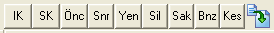

Butonlar, ekranın bağlantılı olduğu tablodaki kayıtlar arasında dolaşabilmek, yeni kayıt girme ortamına geçmek, ekranda bulunan kaydı silmek amacıyla kullanılır. Veri tabanı gezgini olarak NDI uygulamasına özel arama işlemleri bulunmaktadır.

**_Benzer Arama, Kesin Arama;_** Tasarlanan ekranın kullanımı sırasında bu özellikler ile, ekrandaki bir veya birden fazla sahada mevcut olan bilgi(ler) baz alınarak tablodaki kayıtlar içinden arama yapılır. Benzer arama seçeneği ile, saha(lar)daki bilginin içinde geçtiği tüm kayıtlar, kesin arama seçeneği ile ise, saha(lar)daki bilginin aynısına sahip kayıtlar program tarafından belirlenecek ve sonuç kayıtlardan bir kayıt kümesi oluşacaktır. İlk/Son, önceki/sonraki butonları ile bu kayıt kümesinde gezilebilir. Tekrar kayıt kümesinin değiştirilmesi için yeni bir arama yapılması gerekir.

  

**DBSeçim (TNetComboBox)**

Tablodaki ilgili saha evet/hayır gibi iki değerden birini alabiliyorsa, tercih edilecek en uygun bileşendir.

  

**DBMemo (TDBMemo)**

Tabloda uzun metin olarak tanımlanan sahaların sorgulanması için kullanılabilecek ekran bileşenidir. Tabloda _Text_ ve _Clob_ tanımlı alanlar için geçerlidir.

  

**DB Combobox (TNetComboBox)**

Birden fazla seçenekten birinin seçilebileceği saha tiplerinde tercih edilmesi gereken bileşendir. Örneğin cari hareket tipleri, A-Devir, B-Fatura, C-İade fatura, D-Kasa vb. değerler alabilmektedir. Sahanın alabileceği değerler listede gösterilerek kullanıcının bu değerlerden birini seçmesi sağlanır.

  

**DB Tarih (TDBDateTime)**

Tarih alanlarını, kullanıcıya takvim yardımıyla seçtirtebilmek için kullanılan bileşendir.

  

**DB Sayı Giriş (TDBNumber)**

Tablodaki nümerik sahaların ekrandan sorgulanması ve gösterilmesi için kullanılır.

  

**DB Giriş (TDBNEdit)**

Tablodaki uzunluğu belli olan alfa nümerik tüm sahaların ekrandan sorgulanması ve gösterilmesi için kullanılır.

### 1.1.1.2  Object Inspector (Nesne Denetçisi)

VCL’den seçilerek form üzerine yerleştirilmiş olan nesnelerin birtakım özelliklerini belirlemek için kullanılan araçtır. Form üzerinde nesne (bileşen) seçili olduğu durumda, mouse yardımıyla ya da F11 kısa yol tuşuyla object inspector’a geçilebilir.

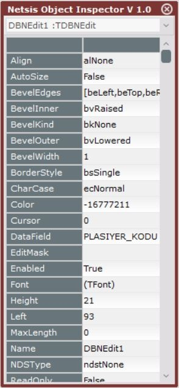

**Object Inspector Genel Kullanımı**

Object Inspector üst bölümünde, seçili nesnenin ismi görülmektedir. Bu kutucukta sağdaki ok tuşuna basıldığında, tüm nesne isimleri görülebilir. Açılan listeden başka bir nesne seçip, seçilen yeni nesne ile ilgili düzenleme yapmak mümkündür.

Nesne listesinin altında ise, seçili nesneye ait özellikler yer almaktadır. Sol tarafta özelliğin ismi, sağ tarafta ise, özelliğin mevcut değerleri görünür. Her bir özelliğin sağındaki bu kutucuklara mouse ile gelinip, özellik değeri değiştirilebilir. Birçok özellik kendine göre belli değerler alabilmektedir. Bu tür özelliklerde mouse ile üzerinde gelindiğinde, ya aşağı doğru ok ya da üç nokta işareti belirmektedir.

Bu işaretler aracılığıyla geçerli değerlerden biri seçilerek özelliğe atanmalıdır.

Forma VCL’den seçilerek eklenen her bileşen belli varsayılan özellikleriyle birlikte eklenmektedir. Bu bölümde sadece nesne üzerinde gerekli değişiklikler yapılmalıdır.

  

**Nesne Isimleri (Name)**

Form üzerine VCL’den seçilerek eklenen bileşenlerin (nesne), varsayılan bir özelliği de isimleridir, yani name özelliği. NDI, eklenen her bileşenin ismini, VCL’deki isminin yanına artan sıra numarası vererek oluşturur ve bileşene atar. Bileşenleri yerleştirdikçe kendinize göre yeni isimler atamakta fayda var. Sonrasında bileşenlerle çalışırken bu isimlerden bileşenleri tespit etmek daha kolay olacaktır. Nesne isimleri verilirken, Türkçe karakterler ve (\_ dışında) işaretler kullanılmamalıdır.

  

**Form Özellikleri**

NDI uygulamasında her bir dizayn için program otomatik olarak fiktif bir form yaratmaktadır. Formun ismine müdahale edilemez.

  

**Bileşenlerin Ortak Özellikleri**

  

**Active**

Grid ve animation bileşenlerinde geçerlidir. Grid için kullanılmamaktadır. Animasyon bileşeninde ise, dosya ismi belirtildikten sonra, kullanım anında animasyonun çalışması için true yapılmalıdır. False kaldığı durumda animasyon bileşeni kullanım anında hareket etmeyecektir.

  

**Align**

Panel, grid, page control gibi form içinde belli bir bölgeye yerleşen bileşenler için geçerli olup, alBottom, alClient, alCustom, alLeft, alNone, alRight, alTop seçenekleri vardır. Seçenekler, formdaki yerleşim yerini ve şeklini belirler.

  

**Alignment**

Bilgi giriş sahası, etiket gibi bileşenlerin içindeki metnin sağa, sola yanaşık ya da ortalanmış görünmesini sağlar. taCenter, taRightJustify, taLeftJustify seçenekleri vardır.

  

**Autosize**

Bileşenin uzunluğunun içerdiği bilgi kadar olmasını sağlar. Sadece etiket bileşeninde, yazılan başlık uzunluğunda olması için true olması önerilir. Diğer bileşenlerde ise tasarım sırasında belirlenen uzunluğun korunması için false olmalıdır.

  

**BevelEdges, BevelInner, BevelKind, BevelOuter, BevelWidth, BorderStyle**

Bileşeni çevreleyen kutucuğun görünümü ile ilgili tanımlardır.

  

**Caption**

Bileşenin form üzerinde görünen başlığıdır. Kullanıcıya görünmesini istendiği şekliyle başlık bilgisi yazılmalıdır. Bu özellik name (isim) özelliği ile karıştırılmamalıdır. Başlık özelliğinde Türkçe vb. istenen karakterler kullanılabilir.

  

**CharCase**

Bileşenin veri girişi sırasında büyük, küçük harfle ya da girildiği şekliyle alınmasını sağlayan özelliktir. ecLowerCase, ecUpperCase, ecNormal seçenekleri mevcuttur.

  

**Color**

Bileşenin görünen rengini değiştirmek için kullanılır. İstenen renk, açılan color palette vasıtasıyla belirlenebilir.

**ColCount**

Grid bileşeninin toplam kolon sayısıdır.

**ColMaxWidth**

Grid bileşeninin kolonları tanımlanırken, ilgili kolonun genişliğinin, içerdiği bilginin en uzun olanına göre dinamik olarak ayarlanmasını sağlayan özelliktir. Bu özelliğin seçilmemiş olma durumunda grid kolonu genişliği tasarım sırasında belirtilen değerde sabitlenecektir.

  

**Cursor**

Kullanım sırasında bileşenin üzerine gelindiğinde cursor tipinin değişmesini sağlar. Standart tip için sıfır bırakılmalıdır.

  

**DataField**

Veri tabanı bileşenleri için geçerli olup, tablodaki ilişkili sahanın belirleneceği özelliktir. Özelliğin yanındaki üç nokta ile, bağlantılı tablodaki alanlar listelenerek içinden istenen saha seçilebilir.

**DbOperation**

DBOperasyon buton bileşeninin veri tabanı gezgini işlevlerini içeren özelliğidir. doFirst, doLast, doPrior, doNext, doPost, doDelete, doInsert, doLikeSearch, doExactSearch değerlerini alabilir. Veri tabanı bileşenleri bölümünde anlatıldığı gibi her bir işlev için forma birer buton eklenirse tam bir gezgin elde edilebilir. Seçeneklerin işlevleri de detaylı olarak _veri tabanı bileşenleri/db Operason_ bölümünde anlatılmıştır.

**Decimal** 

Nümerik sahalar için ondalıklı bölümün basamak sayısı belirlenmelidir.

**EditMask**

Kullanım sırasında sahaya girilebilecek bilginin belli bir formatta girilmesini zorlamak için verilebilecek maskesidir.

**Enabled** 

Ekran üzerinde genelde bilgi amaçlı olup veri girişi amacıyla kullanılmayan sahalar, kullanıcının müdahale etmemesi için enabled özelliği false olur. Kullanıcının müdahale edebileceği sahaların ise enabled özellikleri true olmak zorundadır. Enabled özelliği false olan bileşenlerin renkleri de değiştirilerek ekranda farklı görünmeleri sağlanabilir. Örneğin stok kodu yazıldığında, stok sabit bilgilerinden isim bulunup ekranda görüntülenecekse, stok ismi bileşeninin enabled false olacaktır.

**FileName**

Animasyon bileşeni için eklenecek video dosya isminin belirlenmesine yarar.

**Font**

Bileşenin içerdiği bilginin yazı karakterini belirlemeye yarar.

**Height**

Bileşenin pixel cinsinden yüksekliğini belirlemek içindir.

**ItemIndex**

Combobox bileşeni için default hangi değerin gelmesi istendiğinin belirlenebileceği özelliktir. Default değerin listedeki sıra numarası belirtilmelidir. Listedeki ilk değer sıfırdan başlayarak numaralandırılır.

**Items**

Combobox bileşeni için listedeki seçeneklerin belirleneceği özelliktir. Bu özelliğin sağındaki üç noktaya tıklanarak açılan pencerede, combobox listesinde yer alması istenen seçenekler girilebilir. Açılan pencerede her seçenek bir satır halinde girilmelidir. Örneğin cari hareket tipi seçenekleri her biri bir satıra olmak üzere, “A-Devir”, “B-Fatura”, “C-İade Fatura” ... şeklinde girilmelidir.

**Left**

Bileşenin, form üzerinde, panel ya da page control içindeki yerleşiminin sol kenardan pixel cinsinden uzaklığıdır.

**LUCustEditAck**

Rehber bileşeni için, döndürülmek istenen ikinci bilgi sahasının belirleneceği özelliktir. Örneğin kod ve isim sahalarından oluşan bir rehberimiz bulunduğunu ve form üzerine yerleştirdiğimiz kod ve isim sahalarına rehberden bilgi döndürmek istediğimizi düşünelim. Bu özelliğin sağ tarafındaki üç nokta tıklandığında, form üzerine yerleştirilmiş olan ve bilgi döndürülebilecek tüm sahalar görüntülenecektir. Sahaların içinden isim döndürmek istediğimiz sahayı belirleyebiliriz.

**LUCustomEdit**

Rehber bileşeni için, döndürülmek istenen ana bilgi sahasının belirleneceği özelliktir. Örneğin kod ve isim sahalarından oluşan bir rehberimiz bulunduğunu ve form üzerine yerleştirdiğimiz kod sahasına rehberden seçilen kodun döndürülmesini istediğimizi düşünelim. Bu özelliğin sağ tarafındaki üç nokta tıklandığında, form üzerine yerleştirilmiş olan ve bilgi döndürülebilecek tüm sahalar görüntülenecektir. Sahaların içinden kod döndürmek istediğimiz sahayı belirleyebiliriz.

**MaxLength**

Bileşene kullanım sırasında girilecek bilginin maksimum uzunluğunu belirlemek içindir. Kullanıcı belirlenen uzunluktan fazla sayıda karakter giremeyecektir.

**NDSType**

Tasarlanan formun, Netsis’in diğer paketlerinden birinin içinden çalıştırıldığı durumda geçerli özellik olup, paket içindeki NDS (Netsis Decimal System) tanımlarından hangisinin bileşen için geçerli olduğunun belirlendiği özelliktir.

**OddRowColor**

Grid üzerinde satırların ayrı renklerde gösterilerek kullanıcıya görsel ayrıştırma kolaylığı sağlanmak isteniyorsa, satırların biri beyaz zeminde gösterilmek üzere diğerinin zemin rengi bu özellikle belirlenebilmektedir. Kullanımda grid, bir satırı beyaz, bir satırı belirlenen renkte olmak üzere görünecektir.

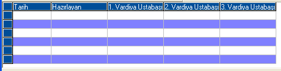 

**PageIndex**

Page Control bileşeninin seçili sayfasının sıra numarasıdır. İlk sayfa 0, ikinci sayfa 1 ... şeklinde numaralandırılmıştır. Sayfalar arasında kaydırma yapmak için, örneğin ikinci sayfayı ilk sayfa olarak değiştirmek için, bu özellik sıra numarası değiştirilebilir. Özellik için değer tanımlandığında, seçili sayfa belirlenen yere taşınacak, diğer sayfalar ise kaydırılarak yer değiştirecektir.

**ReadOnly**

Bileşenin salt okunur özellikte olmasını sağlar.

**RehberKodu**

Rehber bileşeni için, kullanılacak olan rehberin kodunun girileceği özelliktir. Rehberler, NDI Modülünde Rehber Tanımlama bölümünde hazırlanmakta ve tasarımda kodu belirlenerek kullanılabilmektedir. _Bknz: Rehber Tanımlama_.

**ResimDosya**

Resim bileşeni için kullanılacak resmin bulunduğu dosyanın belirleneceği özelliktir. Özelliğin sağındaki üç nokta ile diyalog açılarak dosya yeri belirlenebilir.

**RtrnFldIndex**

Rehber bileşeni için, döndürülmek istenen ikinci bilgi sahasının, rehberdeki kaçıncı saha olduğunun  belirleneceği özelliktir. Rehber tanımlamada rehberde yer alması istenen sahalar tanımlanabilmektedir. Rehber kullanım sırasında, kullanıcı kaydı bulabilmek için bu sahaların içerdiği bilgilerden arama yapabilmekte, kaydı bulduğunda ise, bir bilgi sahasını, örneğin kodu, geri döndürebilmektedir. Rehberin içinde bulunan ikinci bir bilgi sahasının, örneğin isim bilgisinin, form üzerinde bir bileşene döndürülmesi isteniyorsa, bu özellikte, isim sahasının rehberdeki sıra numarası belirtilmelidir. İsim sahasında yer alan bilginin, form üzerindeki hangi bileşene döndürüleceği ise, LUCustEditAck özelliğinde belirtilir.

**ScrollBars**

Uzun metin girişi yapılabilen Memo ve DBMemo bileşenlerinde, yukarı/aşağı ve soldan sağa kaydırma çubuklarının bileşenin içinde yer alıp almaması ile ilgili özelliktir. ssNone (kaydırma çubuğu yok), ssBoth (hem yukarı/aşağı hem de sol/sağ kaydırma çubukları var), ssHorizontal (sadece sol/sağ kaydırma çubuğu var), ssVertical (sadece yukarı/aşağı kaydırma çubuğu var) seçenekleri bulunmaktadır.

**StrColumns**

Grid içinde yer almasını istediğiniz bilgilerin, yani grid sütun tanımlarının yapıldığı özelliktir. Özelliği sağındaki üç nokta tıklandığında karşınıza aşağıdaki ekran gelecektir.

 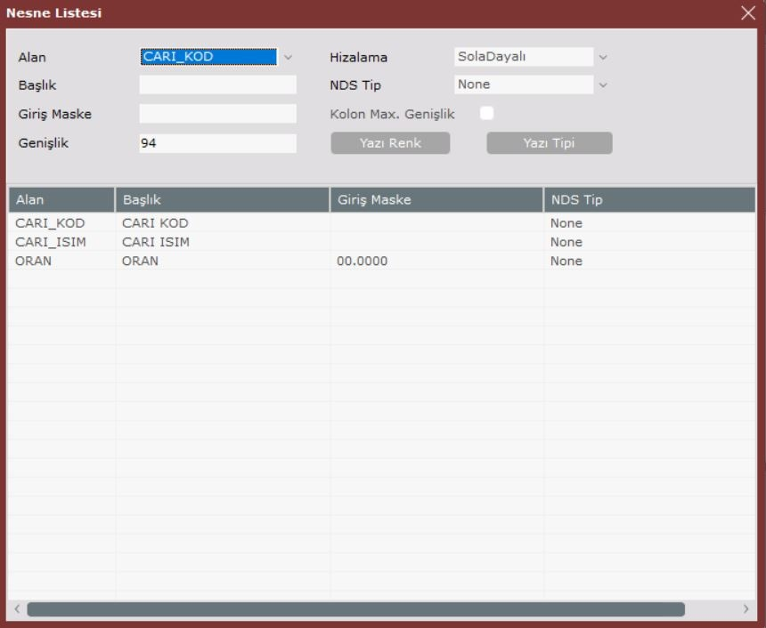

Bu ekranda grid sütunlarını arka arkaya tanımlayabilirsiniz.

**Alan;** Tablodaki hangi alanın görüntülenmesini istediğiniz. Sağındaki ok tuşu ile sahaların listesini açabilir ve içinden bir tanesini seçebilirsiniz.

**Başlık;** Sütunun gridde görüntülenecek olan başlığıdır.

Giriş Maske; Sütunda yer alacak bilgilerin belli bir maske ile görüntülenmesi isteniyorsa, maske bilgisi girilmelidir.

**Genişlik;** Sütun genişliğini pixel cinsinden belirleyebilirsiniz.

**Hizalama;** Bilgilerin sola dayalı, sağa dayalı ya da ortalanmış görüntüleneceğine dair seçenektir.

**NDS Tip;** Netsis’in diğer paketlerinden birinin içinden çalıştırıldığı durumda geçerli özellik olup, paket içindeki NDS (Netsis Decimal System) tanımlarından hangisinin sütun için geçerli olduğunun belirlendiği sahadır.

**Kolon Max Genişlik;** Sütunun içerdiği bilgilerin en genişi kadar dinamik genişlik alması için işaretlenmeli, işaretlenmediği durumda, genişlik olarak belirlenen değer geçerli olacaktır.

**Renk butonu;** Sütunun görünecek renginin belirlenebileceği seçenektir.

**Yazı Yüzü;** Sütundaki bilgilerin yazı tipi (font) ayarının yapılabileceği seçenektir.

**Stretch**

Resim bileşenin görünme şeklidir. Resim bileşeni için belirlenen resmin bileşenin boyutunda ayarlanması için true, resmin kendi boyutunda bileşenin içine yerleştirilmesi içinse false seçilmelidir.

**Style**

Combobox bileşeninin liste şeklinin belirlenmesi içindir. csDropDown (listeden seçilebilir, kullanıcı giriş yapabilir, liste kapalı gelir, kullanıcı isterse açar), csDropDownList (sadece listeden seçilebilir, liste kapalı gelir kullanıcı isterse açar), csOwnerDrawFixed, csOwnerDrawVariable, csSimple (liste açık gelir, kapatılamaz) değerleri alabilir.

**TabIndex**

Page Control içindeki sayfalardan birinin seçili hale getirilmesi için kullanılır. Sayfa numarası yazılmalıdır. Sayfalar ilk sayfa 0, ikinci sayfa 1 ... olmak üzere numaralandırılmıştır.

**TabOrder**

Kullanım sırasında, bileşenin içinde bulunduğu form, panel, page control vb. üzerinde kaçıncı sırada üzerine gelineceğidir. Giriş sırasını belirlemek açısından taborder sıralamasına dikkat etmek gerekir. NDI, bileşenleri forma eklediğiniz sırada numaralandıracaktır. Ancak araya bir bileşen eklerseniz, bu bileşenin üzerine geliş sırası, en son sırada olacaktır. Ekrandaki yerleşim sırasına göre giriş sırasını, taborder özelliğini kullanarak düzenleyebilirisiniz. Tek tek bileşenler için taborder belirlemek yerine sağ click pop-up menüde gelen Sekme Sırası Düzenleme seçeneği kullanılabilir. _Bknz: Sağ Click/ Sekme Sırası_

**TabStop**

Kullanımda giriş sırasında bileşenin üzerinde durulup durulmayacağı ile ilgilidir. Örneğin giriş sırasında, herhangi bir zamanda grid bileşeninin üzerine gelip durmaya gerek yoktur, çünkü grid bilgi amaçlıdır. Grid bileşeni için tabstop false yapılabilir. Ancak bilgi girişi yapılacak bir okuma alanı (NetEdit ya da dbNetEdit) için tabstop true olmalıdır. Bilgi girişi yapılmayacak olan, sadece bilginin gösterilmesi için konmuş olan editler, örneğin rehberden dönen kodun isminin gösterildiği saha, için ise false yapılabilir.

**TabVisible**

Page Control bileşeninin içine yerleştirilen sayfaların görünüp görünmeyeceği bilgisidir.

**Tag**

Programcının özel kullanımı içindir.

**Text**

Bileşenin içinde yer almasını istediğiniz default bilgidir. Kullanımda form açıldığında bileşen bu değeri alacaktır. Bileşenin içinde herhangi bir bilgi yer alması istenmediği durumda özellik değeri boşaltılmalıdır.

**Top**

Bileşenin, form üzerinde, panel ya da page control içindeki yerleşiminin üst kenardan pixel cinsinden uzaklığıdır.

**ValueChecked**

DBCheckBox bileşeni için, kullanımda işaretlendiği ve işaretlenmediği durumda veri tabanına saklanacak değerleri belirlemek içindir. Bu özellikte işaretli durum değeri verilmelidir.

**Values**

DBComboBox ileşeni için, items özelliğiyle listeye eklenen her bir seçeneğin veri tabanına saklanacak değeridir. Açılan pencerede her satıra bir değer olmak üzere alt alta sıralanmalıdır.

**ValueUnchecked**

DBCheckBox bileşeni için, kullanımda işaretlendiği ve işaretlenmediği durumda veri tabanına saklanacak değerleri belirlemek içindir. Bu özellikte işaretsiz durum değeri verilmelidir.

**Visible**

Bileşenin görünüp görünmeyeceği bilgisidir.

**Width**

Bileşenin pixel cinsinden genişliğidir.

### 1.1.2.  Tasarım Sağ Click Menü Kullanımı

Tasarım üzerindeyken sağ click ile açılan pop-up menüde önemli işlemler yapılabilmektedir.

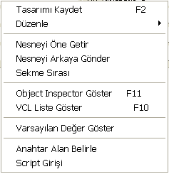

**Özel İşlemler**

Sadece page control bileşeni seçiliyken sağ click yapıldığında gelen seçenek olup, page control içinde, yeni bir sayfa yaratmaya, sayfalar arasında geçiş yapmaya, mevcut bir sayfayı silmeye yarar. _Bknz: VCL/Page Kontrol_

  

**Tasarımı Kaydet (F2)**

Tasarımı mevcut son haliyle kaydetmeye yarar. F2 kısa yol tuşu da aynı işleve sahiptir.

  

**Düzenle/ Kopyala, Kes, Yapıştır, Sil**

Seçili bileşen için Windows standart kullanımında yapılabilen kopyala, kes, yapıştır ve sil işlemlerini yapar. Bu işlemlerin standart Windows kullanımındaki kısa yol tuşları da geçerlidir.

  

**Nesneyi Öne Getir**

Tasarımda üst üste binmiş nesneler varsa, seçili olanı öne getirmeye yarar.

  

**Nesneyi Arkaya Gönder**

Tasarımda üst üste binmiş nesneler varsa, seçili olanı arkaya göndermeye yarar.

#### 1.1.2.1. Sekme Sırası;

Bu seçenekle, kullanım sırasında, bileşenlerin üzerine hangi sırada gelineceği yani giriş sırası listelenmektedir. Sıralama, içinde bulunulan form, panel, page control vb. birden fazla bileşen içeren kontrol ile ilgili olarak listelenir. Farklı bir bölümün sıralaması için, ilgili bölüm seçilerek sağ click yapılmalıdır. Giriş sırası mouse ile bileşenler kaydırılarak düzenlenebilir. Bu liste bileşenlerin forma eklenme zamanına göre sıralanır. Araya bir bileşen eklenirse, bu bileşenin üzerine geliş sırası, en son sırada olacaktır. Ekrandaki yerleşim sırasına göre giriş sırasını, bu listeden düzenleyebilirsiniz. Bu liste aynı zamanda bileşenlerin tab order özelliğini yansıtır. Listede yapılan kaydırmalara göre program otomatik taborder özellikleri atayacaktır.

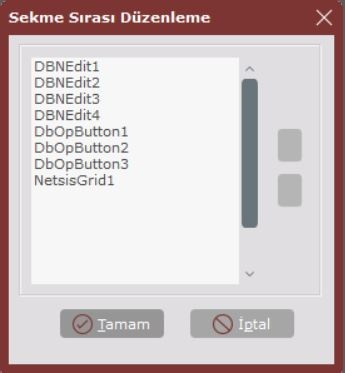

**Oject Inspector Göster (F11)**

Tasarımdan Object Inspector penceresine geçişi sağlar. Object Inspector’da seçili bileşen için özellik tanımları gelir. F11 kısa yol tuşu da aynı işleve sahiptir.

  

**VCL Liste Göster (F11)**

Tasarımdan VCL (Visual Component Library) penceresine geçişi sağlar. F10 kısa yol tuşu da aynı işleve sahiptir.

#### 1.1.2.2. Varsayılan Değer Göster;

İstenen bileşenlere kullanım sırasında varsayılan değerler atamak mümkündür. Form açıldığında, ya da veri tabanı bağlantılı formda, yeni kayıt durumuna geçildiğinde, burada tanımlanan varsayılan (öndeğer, default) değerler gelecektir.

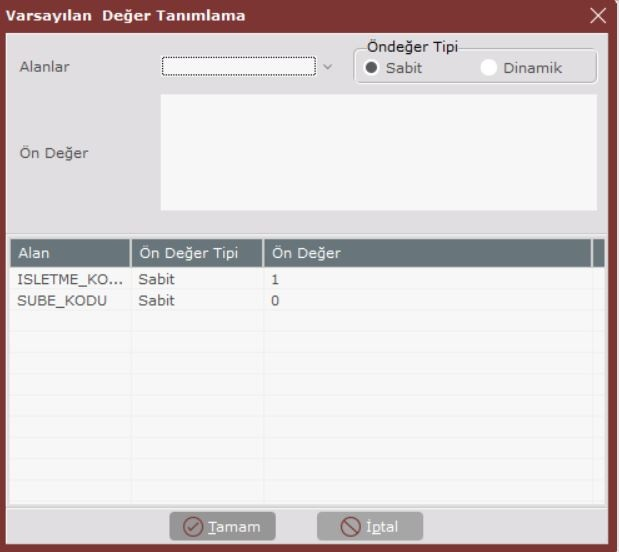

**Alanlar**

Hangi alan için varsayılan değer tanımı yapılacağı belirlenir. Sağ tarafındaki ok tuşu ile alanlar içinden seçim yapılabilir.

**Öndeğer Tipi**

Sabit bir öndeğer belirtilebileceği gibi, dinamik anlık oluşan bir öndeğer de belirlenebilmektedir.

**Öndeğer**

Sabit öndeğer ya da dinamik oluşturulmak istenen öndeğer için sql cümlesi yazılarak belirlenir. Örnek select getdate() cümlesi ile tarih sahasına günün tarihi öndeğer olarak getirilebilir.

  

**Ön Değer Sil**

Tanımlanan öndeğerler pencerenin alt bölümündeki gridde görülebilmektedir. İstenmeyen kayıtlar seçilerek sağ click’te gelen Ön Değer Sil seçeneği ile silinebilir.

#### 1.1.2.3. Anahtar Alan Göster;

Veri tabanı bağlantılı ekranlarda, tablodaki hangi saha(lar)ın tekrarsız anahtar oluşturduğunun belirlenmesi gerekmektedir. Tüm veri tabanı üzerinde yapılacak işlemler (ilk/son kayıt, önceki/sonraki kayıt, yeni kayıt, silme vb.) bu anahtar alan(lar) baz alınarak yapılacaktır. Ekranla bağlantılı olan tabloda bir primary key (tekrarsız anahtar alan) yoksa, geri dönüp öncelikle böyle bir alan tespit edip sql yardımıyla tablonuzda bunu belirtmelisiniz. Böyle bir alanınız mevcut ise, ekranda Anahtar Alan Göster işlemiyle mutlaka anahtar alanınızı forma tanıtmalısınız. Anahtar Alan Göster işleminde açılan pencerede, sol tarafta tablonuzdaki alanlar sıralanacak. Anahtar alanınızı belirleyip ekle butonu ile sağ taraftaki anahtar alanlar bölümüne ekleyebilirsiniz. Birden fazla alanın birleşmesiyle oluşan bir anahtarınız varsa (segmented key) bu durumda alanları sırasıyla seçip ekleyiniz. Yanlışlıkla eklenmiş bir anahtar alanı seçiliyken çıkar butonuna basarak listeden çıkarabilirisiniz. Pencerenin alt tarafındaki tamam butonu ile değişiklikleri saklayarak, iptal butonu ile değişiklikleri saklamadan pencereyi kapatabilirsiniz.

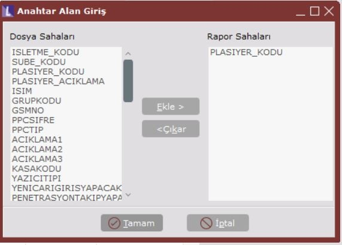

#### 1.1.2.4. Script Girişi;

Bileşenler ve özellikleri kullanılarak yapılan uygulama tasarımında ayrıca programlama yapılmasını gerektiren durumlarda script girişi kullanılabilir.

  

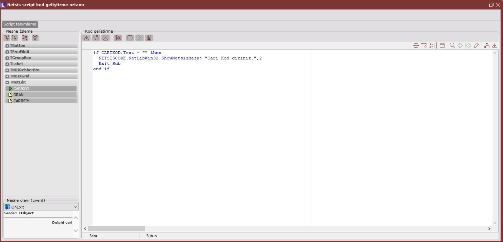

Script girişinde Visual Basic dili tam anlamıyla desteklenmekte olup bu dil kullanılarak istenildiği şekilde programlama yapılabilir. NDI formunun mevcut bileşenleri, özellikleri ile NDI’a özel geçerli değişkenler, script ortamında kullanılabilmektedir. Script ile yapılabileceklere birkaç basit örnek verecek olursak, bir veri giriş bileşenine kullanıcının yazdığı değerin, bileşenin çıkışında (onexit) kontrol ederek geçerli bir değer olup olmadığını saptamak, geçersiz değer ise uyarı vermek ve işlemi durdurmak; Bir butona basıldığında ya da yine bir bileşenin çıkışında birtakım hesaplamalar yapmak ve sonucu form üzerinde göstermek, bir butona basıldığında başka bir pencere açılmasını sağlamak vb.dir.

  

**Script Giriş Ekranı Kullanımı;**

Script giriş ekranında, ekranın sol kısmında, hangi bileşenin hangi olayı (event) için script yazılacağı belirlenmektedir.

  

**Nesne**

Form üzerindeki hangi bileşenin bir olayı sonucunda işlem yapılacağının belirlendiği sahadır. Sağındaki aşağı ok yardımıyla form üzerindeki bileşenlerden biri seçilebilir.

**Olay**

Nesnenin hangi olayı (event) sonucunda yazılan script’in çalışacağı belirlenir. Seçilen nesneye göre farklı olaylar geçerlidir. Sağıdaki ok yardımıyla seçilen nesne için geçerli olaylar içinden bir tanesi seçilebilir.

**Script Araç Çubuğu;**

 **Object Help;** Script içinde geçerli kütüphanede yer alan nesneler ve özellikleri (method ve property) ile ilgili detaylı bilginin yer aldığı bölümdür.

 **Kod Tamamlama (Code Complete);** Belli kalıplarda kod bloklarının otomatik olarak tamamlanması için kullanılabilir. Örneğin “if” ibaresi yazılarak bu tuşa basıldığında, bir if-then-else bloğunun düzgün syntax ile tamamlanması sağlanabilir.

 **Kod İçeriği (Code Insight);** Script içinde kullanılabilecek NDI kütüphanesi nesneleri ile nesnelere ait property ve method’ların listesinin getirilebileceği tuş. Script Giriş Bölümünde anlatılan Ctrl-boşluk tuşu ile aynı işleve sahiptir.

 **Git (Go To);** Bu butona basıldığında gitmek istediğiniz satır numarası sorgulanacak ve cursor kod içerisinde verilen satır numarasına gidecektir.

 **Ara;** Kod içerisinde belli bir karakter dizisiniz aramak amacıyla kullanılır. Aranması istenen karakter dizisi, büyük/küçük harf duyarlı, sadece kelime, imleçten itibaren ara, sadece seçili metinde ara seçenekleri ile ileri/geri yönde aranabilmektedir.

 **Ara Sonraki, Önceki;** Kod içerisinde arama yapılıp verilen karakter dizisi bulunduktan sonra, aynı karakter dizisinin, verilen arama kriterleri ile, sonrakini/öncekini bulmaya yarayan butonlardır.

 **Bul/Değiştir;** Arama işlevinin, bulunan karakter dizisi yerine başka bir karakter dizisini otomatik olarak yerleştirme amacıyla kullanılması içindir. Aranacak karakter dizisi ile yerine yerleştirilecek karakter dizisi belirtilmelidir. Büyük/küçük harf duyarlı, sadece kelime, imleçten itibaren ara, sadece seçili metinde ara seçenekleri ile ileri/geri yönde arama geçerlidir. İlk bul/değiştir işleminden sonra, sonraki/önceki için yukarıda belirtilen butonlar kullanılabilir.

 **Script Sakla/Yükle;** Yazılan scriptin dış ortama text dosya olarak aktarımı ya da dış ortamdaki bir scrip’in text dosyadan editöre yüklenmesi.

  

**Script Giriş Bölümü;**

Ekranın ortasındaki boş alan script girişi için editor olarak tasarlanmıştır. Burada istenildiği gibi Visual Basic kod yazılarak bir takım işlemlerin gerçekleşmesi sağlanabilir. Ortamda, kütüphane olarak mevcut birtakım NDI nesneleri ve bu nesnelere ait özellikler (property ve method) Visual Basic syntax standartlarında kullanılabilir. Editörde Ctrl-Boşluk tuş takımı ile, kullanıma açılmış olan bu NDI nesneleri getirilebilmektedir. Ctrl-Boşluk ile açılan _Netsis Code Insight_ penceresinden bir nesne seçilip tekrar ctrl-boşluk ile seçilen nesnenin özelliklerini getiren yeni bir Code Insight penceresi açılabilir. Buradan da nesnenin istenen kullanılacak özelliği seçilebilir. Örnekte, bir kodlama sahası çıkışında, yazılan kodun geçerli olup olmadığı kontrol edilerek, mevcut olmayan bir kod ise uyarı verilmesi sağlanmıştır.

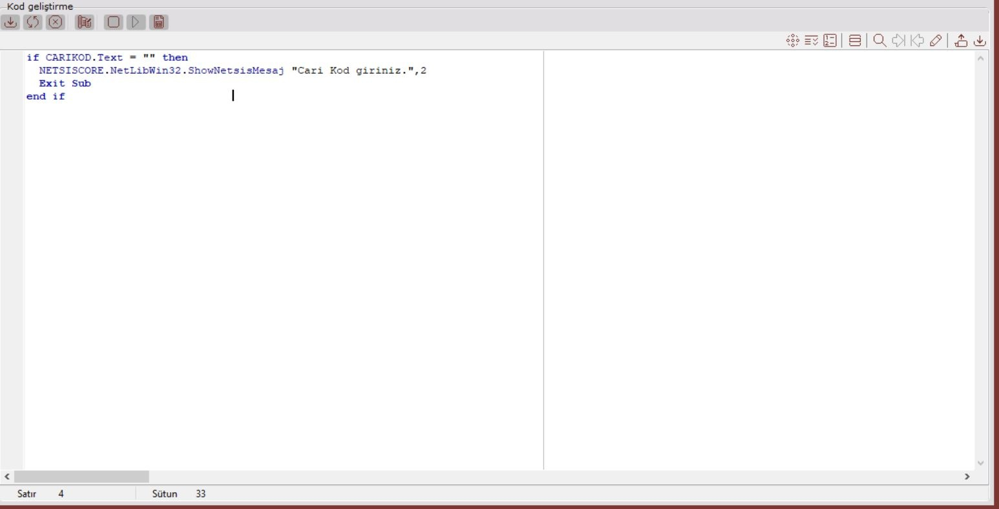

## **1.2.  Rehber Tanımlama**

Rehber Tanımlama seçeneği ile, NDI tasarımlarında kullanılacak olan her çeşit rehber tanımlanabilir, topluca izlenebilir ve yönetilebilir. Bu bölümde tanımlanan bir rehber, aynı amaca hizmet eden birçok tasarımda ve bir tasarım içinde birden fazla kez kullanılabilir. Rehberin tasarıma eklenmesi için _VCL/Rehber tuşu_ kullanılmalıdır. Geniş açıklamayı _Dizayn Ortamı_ bölümünde bulabilirsiniz.

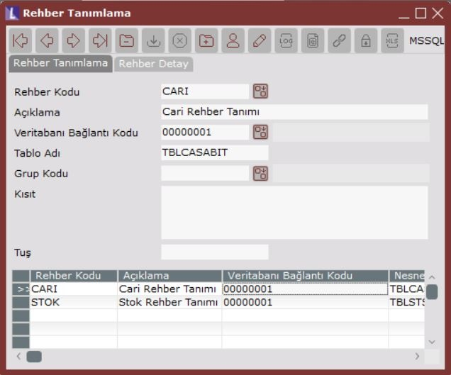

  

**Rehber Kodu**

Tanımlanan her rehber için serbest ve tekrarsız bir kod belirlenmelidir. Kendi sistematiğinize göre burada kodlamanızı yapabilirsiniz. Belirlenen kod dizayn ortamında tasarıma eklenen rehber tuşunun rehber kodu özelliğinde belirtilecektir. _Bknz: Dizayn Ortamı_.

  

**Açıklama**

Tanımlanan rehbere ait açıklama bilgisi girilecek alandır. Hatırlatma amacıyla, rehberin içeriği ve kullanım amacı ile ilgili bilgi yazılmasında fayda var.

  

**DB Bağlantı Kodu**

NDI ile birden fazla veri tabanında bulunan tablolar için rehber tanımlanabilmektedir. Örneğin, hem Temelset hem de Personel veri tabanlarına ait rehber tanımlanabilir. Veri tabanı bağlantıları dokümanın ilerleyen bölümlerinde anlatılacak olan başka bir menü seçeneğinden yapılmaktadır. _Bknz: DB Bağlantı Tanımlama._ Her bir veri tabanı bağlantısı tanımına bir kod verilecektir. Bu sahada ise, tanımlanan veri tabanı bağlantılarından hangisinin kullanılacağı, veri tabanı bağlantı kodu verilerek  belirlenecektir. Tanımlı veri tabanı bağlantıları, sahanın rehberi aracılığıyla da belirlenebilir.

  

**Object Adı**

Rehber ile ilişkili olan, arama yapılacak ve görüntülenecek tablo ya da view’un veri tabanındaki adıdır. Tablo ya da view’un dizayn öncesinde, veritabanında SQL komutları yardımıyla yaratılmış olması gerekmektedir.

  

**Grup Kodu**

Hazırlanan rehberlerin gruplanması isteniyorsa bu sahada, ilgili rehberin içinde yer alacağı grubu belirtebilirsiniz. Kendi sistematiğinize göre gruplandırmayı yapabilirisiniz. Herhangi bir grup kodu verilmezse, NDI, rehberi GENELREHBER grubu altına alacaktır.

  

**Kısıt**

Rehberin düzenlendiği tablodaki herhangi bir sahaya kısıt verilerek, rehberde gelen kayıt kümesinin daraltılması sağlanabilir. Kısıt cümlesi, SQL cümlelerinin WHERE ile başlayan kısıt bölümünde yazılan formatta olmalıdır.

  

**Tuş**

Rehber kısa yol tuşudur. Kullanımda, ctrl ile birlikte bu tuşa basıldığında, rehber aktif hale gelir.

### **1.2.1.  Rehber Detayları**

Rehber ana tanımları tamamlandıktan sonra ve rehber tanımı ekranda seçiliyken, aynı ekrandaki ikinci sayfaya (Rehber Detay sayfasına) geçilerek rehber sahalarının tek tek tanımları yapılabilir.

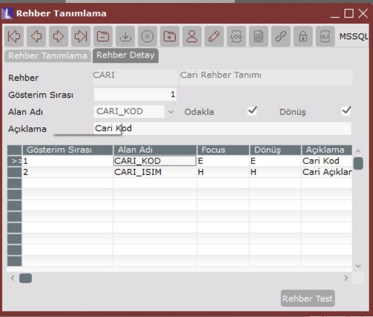

  

**Rehber**

Detayları tanımlanan rehberin kodu ve açıklaması bilgi olarak gösterilmektedir.

**Display Order**

Tanımlanacak sahanın rehberde kaçıncı sırada getirileceğinin bilgisidir.

  

**Field Name**

Rehbere getirilecek olan sahanın tablodaki saha ismi karşılığıdır.

  

**Açıklama**

Rehbere getirilecek olan sahanın rehber sütun başlığıdır.

  

**Focus**

Rehber açıldığında arama amaçlı üzerinde durulacak olan sahanın hangisi olacağının belirlendiği bilgidir. Örneğin kod ve isim bilgilerinden oluşan bir rehberde, ilk saha kod ve ikinci saha isim olarak tanımlanmış olabilir. Ancak sıklıkla isimden arama yapılacağı düşünüldüğünden rehber ilk açıldığında cursor’ın isim sahası üzerinde durması istenebilir. Rehber için tanımlanan sahalardan sadece bir tanesinin Focus özelliği işaretlenebilmektedir.

  

**Return**

Rehber kullanılıp, arama sonucu bir kayıt tespit edildikten sonra, rehberden uygulamaya döndürülmesi istenen sahanın hangisi olduğunun belirlendiği bilgidir. Örneğin kod ve isim bilgilerinden oluşan bir rehberde kod bilgisi uygulamaya döndürülmek istenecektir. Rehber için tanımlanan sahalardan sadece bir tanesinin Return özelliği işaretlenebilmektedir.

  

**Rehber Test**

Tanımlanan rehberin çalışmasını test etmek amacıyla bu buton kullanılabilir.

### 1.2.2.  Kullanım Sırasında Rehber

Uygulamanın kullanımı sırasında rehber tuşuna tıklandığında ya da rehberin kısa yol tuşu ile rehber açılır.

  

Rehber penceresinde, hangi sahadan arama yapmak isteniyorsa, mouse ile ekranın üst kısmında yer alan saha isimlerinden seçilir. Saha isimlerinin altında gelen boş bilgi giriş sahasına aranmak istenen karakterler yazılır. Tüm kayıtların listelenmesi için bu saha boş bırakılabilir. Sahanın sağındaki arama butonuna basılarak istenen kayıt kümesi, rehberin alt kısmındaki gride getirilir. Kayıtlar getirildiğinde, alfabetik sıraya göre küçükten büyüğe sıralı görülecektir. Aynı zamanda arama ikonu yukarı/aşağı ok işaretleri olarak değişir.

Yukarı/Aşağı oklara basılarak, gridde görünen kayıt kümesinin alfabetik sırada küçükten büyüğe ya da büyükten küçüğe sıralanması sağlanabilir.

Son olarak griddeki kayıt kümesinden aranan kayıt tespit edildiğinde, üzerinde çift tıklanarak bilginin uygulamaya döndürülmesi sağlanabilir. Uygulamaya herhangi bir bilgi döndürülmeksizin rehberin kapatılması için Alt-F4 tuş takımı, sağ üst köşedeki kapat işareti ya da ESC tuşu kullanılabilir.

### 1.2.3.  Tasarımda Rehber Kullanımı

Tasarım anında VCL’den rehber tuşu seçilerek dizayna eklenmelidir. Eklenen rehber tuşu seçili iken, Object Inspector’a geçilerek, rehber ismi, rehber kodu, LUCustEditAck, LUCustomEdit ve RtrnFldIndex özellikleri belirtilmelidir. VCL rehber tuşu ve özellikleri kullanımı için _bknz: Dizayn Ortamı_.

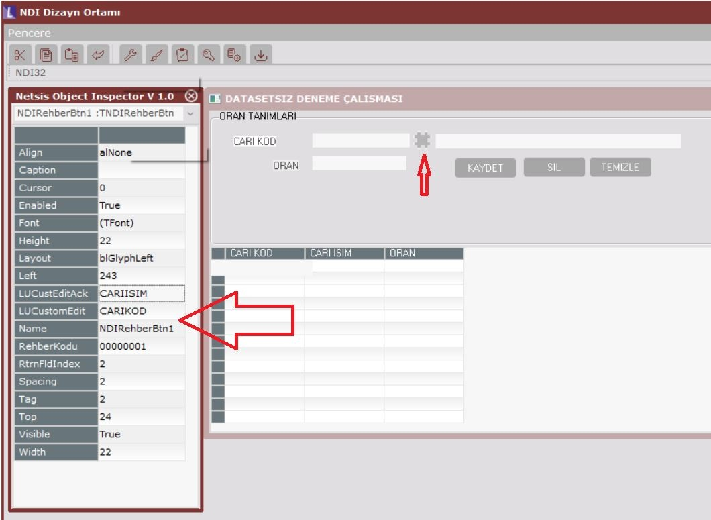

## 1.3.  Ekran Hakları Tanımlama

NDI ile tasarlanan nesnelerin, NDI uygulamasından kullanımı ile ilgili kullanıcı hakları belirlemeye yarayan bölümdür. NDI ile tasarlanan ekranlar Temelset vb. diğer paketlerden kullanılacaksa burada herhangi bir tanımlama yapmaya gerek yoktur.

herhangi bir tanımlama yapmaya gerek yoktur.

  

Kullanıcılar ve kullanıcı grupları, NDI ana uygulamadaki Kullanıcı Tanımları modülünden yapılmalıdır. Kullanıcı Tanımları Modülünde kullanıcıların NDI uygulamasında, tasarımla ilgili menülerin kullanımındaki hakları belirlenmektedir. Bu bölümde ise, NDI ile geliştirilen uygulamanın kullanım hakları tanımlanmaktadır. Kullanıcı tanımları modülü, Temelset ve diğer Netsis paketlerinde bulunan Kullanıcı Tanımları modülleri ile aynı olup, ilgili dokümanlardan bilgi alınabilir.

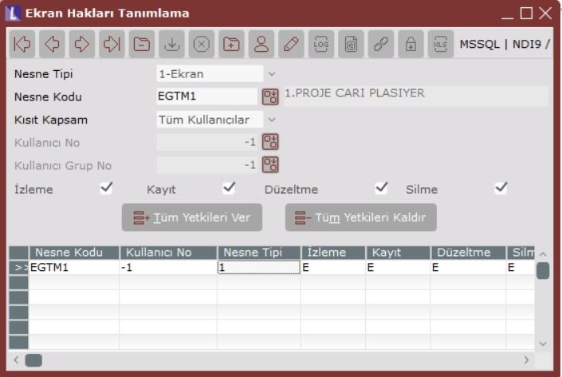

  

  

**Nesne Tipi**

Kullanıcı hakları belirlenecek olan nesne tipinin seçileceği alandır. Tasarlanan ekranlar, raporlar ve rehberler için kullanıcı hakları tanımlanabilmektedir.

  

**Nesne Kodu**

Dizayn Hazırlama ile hazırlanmış olan dizaynın, Rehber Tanımlama ile hazırlanmış olan rehberin ya da rapor modülünde hazırlanmış raporun kodudur.

**Kısıt Kapsam**

Kullanıcı haklarının, tek bir kullanıcı, kullanıcı grubu ya da tüm kullanıcılar bazında tanımlanacağının bilgisidir.

**Kullanıcı No, Kullanıcı Grup No**

Bir tek kullanıcı ya da kullanıcı grubu için hak tanımlanması isteniyorsa, kısıt kapsam sahasında belirlenen seçeneğe göre kullanıcı kodunun ya da grup kodunun girileceği sahalardır. Rehberden yararlanarak tanımlı kullanıcılardan ya da gruplardan seçim yapılabilir.

**İzleme, Kayıt, Düzeltme, Silme**

Belirlenen kullanıcı, kullanıcı grubu ya da tüm kullanıcıların, bu nesne üzerinde yapabileceği işlemlerin belirlenebileceği sahalardır. Yapılması istenen işlemler işaretlenmeli, engellenmesi istenen işlemler ise işaretlenmemelidir.

  

**Tüm Yetkileri Ver**

İzleme, Kayıt, Düzeltme, Silme işlemlerinin tamamının tek tuşla verilmesine (işaretlenmesine) yarar.

  

**Tüm Yetkileri Kaldır**

İzleme, Kayıt, Düzeltme, Silme işlemlerinin tamamının tek tuşla engellenmesine (işaretlenmemesine) yarar.

## 1.4.  DB Bağlantı Tanımlama

NDI aracılığıyla yapılan dizaynlar ile ilgili veri, istenen herhangi bir veri tabanında saklanabilmektedir. İstenirse, veriler birden fazla veri tabanında da bulunabilir. Bu bölüm, NDI uygulaması ile bu veri tabanları arasındaki bağlantıları tanımlamak amacıyla kullanılır.

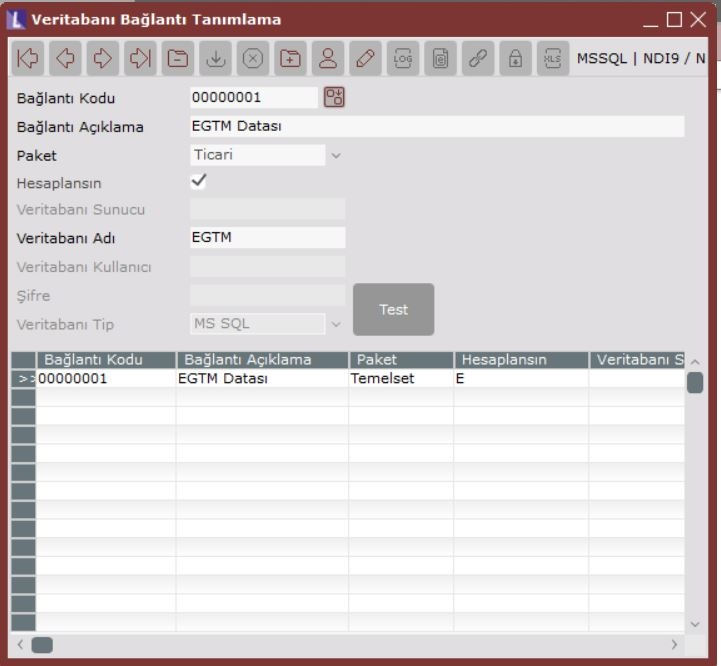

  

**Bağlantı Kodu**

Tanımlanan her veri tabanı bağlantısı için serbest ve tekrarsız bir kod belirlenmelidir. Kendi sistematiğinize göre burada kodlamanızı yapabilirsiniz. Belirlenen kod dizaynların ve rehberlerin db bağlantı kodu bilgisinde belirtilecek olup, dizaynı ya da rehberi ilgilendiren verinin hangi veri tabanında bulunduğunu tanımlar. 

**Bağlantı Açıklama**

Veri tabanı bağlantısının açıklamasıdır. Hatırlatma amacıyla açıklayıcı bilgi yazılmalıdır.

  

**Paket**

NDI, Ticari, Personel, Demirbaş, İşletme, Diğer (Netsis paketleri dışında bir uygulama) paketleri arasından seçilebilir. Netsis paketlerinden birine bağlantı yapılıyorsa, program otomatik olarak ilgili paketin hangi veri tabanı sunucusunda çalıştığını algılar.

  

**Hesaplanacak**

Veri tabanı bağlantısı, Netsis’in diğer paketleri içinden kullanılacak nesneler için tanımlanıyorsa, mutlaka hesaplanacak seçeneği işaretlenmelidir. Bu durumda, nesne paketin içinden çalışırken, db bağlantısını kendi içinde çalıştığı paketinkiyle aynı şekilde yapabilecektir.

  

**VT Sunucu**

Netsis paketleri dışında bir paket ile bağlantı yapılacak ise, veri tabanı sunucusunun ismi yazılmalıdır. Netsis paketleri ile bağlantıda, bağlanılacak veri tabanı sunucusu bilgileri, pakete ait kurulum bilgilerinden otomatik alınır ve sorgulanmaz.

  

**VT Adı**

Bağlanılacak veri tabanının adı belirtilmelidir.

  

**VT Kullanıcı**

Bağlanılacak veri tabanı için hakları bulunan geçerli bir kullanıcı ismi belirtilmelidir. Dikkat, bu bölümdeki kullanıcı ismi veri tabanı kullanıcısı olup, Netsis paketlerinde tanımlanan kullanıcı isimleriyle ilgisi yoktur. NDI ve Diğer dışında, Netsis paketlerinden bir tanesi için bağlantı tanımlanıyorsa kullanıcı adı sorgulanmayacaktır. Bu durumda, veri tabanı kullanıcı ismi, pakete ait kurulum bilgilerinden otomatik alınır.

  

**Şifre**

Veri tabanı kullanıcısının veri tabanına bağlanmak için kullandığı şifredir. NDI ve Diğer dışında, Netsis paketlerinden bir tanesi için bağlantı tanımlanıyorsa kullanıcı adı sorgulanmayacaktır. Bu durumda, veri tabanı kullanıcı şifresi, Netsis’in güvenlik standartlarına göre otomatik oluşturulur.

  

**VT Tip**

NDI ve Netsis paketleri dışında bir paket ile bağlantı yapılacak ise bu alan sorgulanır, Netsis paketleri bağlantılarında ilgili paketin kurulum bilgilerinden otomatik alınır. MSSQL, Oracle ve DB2 veri tabanları desteklenmektedir.

  

**Test**

Veri tabanı bağlantı tanımının geçerli olup olmadığının kontrolü bu buton yardımıyla yapılabilir. Eğer geçerli bir tanımlama yapılmışsa, başarılı bir bağlantı yapıldığına dair uyarı alınacaktır. Eğer bağlantı tanımı geçersiz ise, veri tabanına bağlanmaya çalışıldığında alınan hata, uyarı olarak karşınıza gelecektir. Netsis paketleri içinden kullanılacak olan bağlantıları (paket seçilmiş ve hesaplanacak olan) NDI ortamından test etmek mümkün değildir.

## **1.5.  Grup Kodu Tanımlama**

Dizayn, rehber ve raporların gruplandırılması için grup kodu ve açıklama tanımlanabilecek bölümdür.

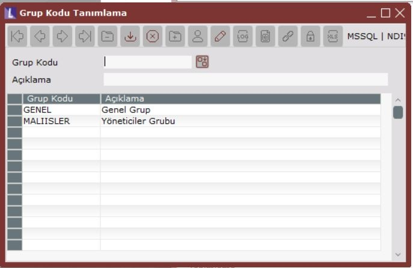

## **1.6.  Şirket Tanımlama**

NDI uygulaması yüklendiğinde NDI32 adında bir veri tabanı ile çalışmaktadır. NDI uygulamasında yapılan tanımların bilgileri ve istenirse uygulamanın kullandığı veriler, bu veri tabanında bulunmaktadır.

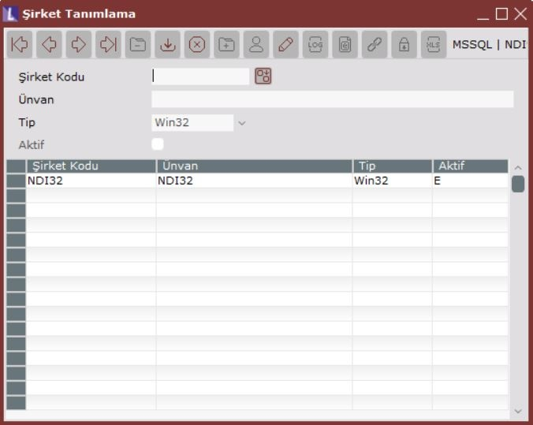

Farklı bir uygulama tasarımı, farklı kullanıcı tanımları vb. amaçlarla istenirse yeni bir şirket açılarak, programa giriş ya da şirket değiştirme bölümlerinden çalışılacak şirket belirlenerek ilgili şirkete geçilebilir.

## **1.7.  Şirket Parametreleri**

İçinde bulunulan NDI şirketine ait ana parametrelerin bulunduğu bölümdür.

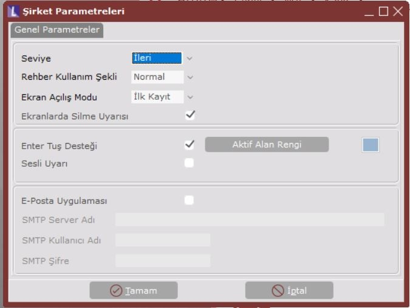

  

**Seviye**

NDI kullanımı İleri/Kolay olmak üzere iki seviyede belirlenebilmektedir. İleri seviyede kullanıldığında, Dizayn Hazırlama/Dizayn Ortamı/VCL (Visual Component Library) bölümündeki “İleri” sayfası ve içindeki bileşenler kullanılabilir. Kolay seviyesinde ise, bu bölümde “İleri” bileşenler kullanılamamaktadır.

  

Diğer parametreler Temelset ve diğer Nestsis paketlerindeki ilişkin parametre tanımlarının aynısıdır. Detaylı bilgiyi ilgili dokümanlardan alabilirsiniz.

## **1.8.  İşlemler/Export/Import XML**

NDI uygulamasında hazırlanan dizayn ve rehberler istenirse XML formatında dış bir ortama saklanır ve başka bir NDI uygulaması tarafından yüklenebilir.

### 1.8.1.  Export

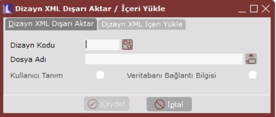

  

NDI uygulamasında hazırlanan bir dizayn ya da rehberin dış ortama XML formatında aktarılması için kullanılır.

**Design Kodu**

Aktarılmak istenen dizaynın, dizayn tanımlamada belirlenen kodudur.

  

**Dosya Adı**

Aktarılmak istenen fiziksel dosya ismi olup, ekrandaki yardım butonu aracılığıyla klasör ve dosya ismi belirlenebilir.

  

**Kullanıcı Tanım**

Kullanıcı Tanımlarının aktarılması, aktarılan bu nesnenin, yüklenmesi sırasında, karşı taraftaki NDI uygulamasında bulunan tüm kullanıcılara bu nesne ile ilgili tüm hakların verileceği anlamına gelir. Kullanıcı Tanımları aktarılmamış ise, nesnenin yüklenmesi sırasında karşı taraftaki NDI uygulamasında herhangi bir kullanıcı hakkı tanımlanmayacak, kullanıcılar yüklenen bu nesneyi göremeyecekler, kullanıcı haklarının yükleme sonrasında ayrıca yapılması gerekecektir.

  

**Veri Tabanı Bağlantı Bilgisi**

Veri tabanı bağlantı bilgisinin de nesneyle birlikte transfer edilip edilmeyeceğini belirlemek içindir. Veri tabanı bağlantısı transfer edilmediği durumda, başka NDI paketine bu XML yüklendiğinde, dizayn tanımında veri tabanı bağlantısı oluşturulması gerekecektir.

### 1.9.2.  Import

  

NDI uygulaması tarafından XML dosyaya export edilmiş bir dizayn ya da rehberin, başka bir NDI uygulamasına yüklenmesi için kullanılır.

**Dosya Adı**

Yüklenmesi istenen fiziksel dosya ismi olup, ekrandaki yardım butonu aracılığıyla klasör ve dosya ismi belirlenebilir.

  

**Nesne Adı**

Yüklenecek nesnenin kodu, XML dosyadan bulunarak getirilmektedir. İstenirse değiştirilerek farklı bir kodla yüklenebilir.

  

**Vt Bağlantı Kodu**

Yüklenecek nesnenin XML dosyaya aktarımı sırasında veritabanı bağlantı kodu aktarılmış ise bu bilgi otomatik getirilecektir. İstenirse değiştirilip mevcut veri tabanı bağlantılarından biri kullanılabilir. Eğer veri tabanı bağlantı bilgisi aktarılmamışsa bu saha okutulmayacaktır ve nesnenin veri tabanı bağlantı bilgisi oluşmayacaktır. Bu durumda nesnenin tasarlandığı bölümden bu bilgi düzenlenmelidir.

# **2.    Kullanıcı İşlemleri**

Kullanıcılar ve kullanıcı grupları, bu modülden yapılmalıdır. Modülün kullanımı, Temelset ve diğer Netsis paketlerinde bulunan Kullanıcı İşlemleri modülleri ile aynı olup, ilgili dokümanlardan bilgi alınabilir. Kullanıcı İşlemleri Modülünde kullanıcıların NDI uygulamasında, tasarımla ilgili menülerin kullanımındaki hakları belirlenmektedir. NDI aracılığıyla tasarlanan uygulamaların kullanımındaki haklar ise, Ekran Hakları Tanımlama bölümünde tanımlanabilir. _Bknz: Ekran Hakları Tanımlama_.

# **3.    Rapor Modülü**

NDI Rapor Modülü kullanımı Temelset rapor modülü ile aynıdır. Bu nedenle kullanım detaylarına bu dokümanda girilmeyecektir.

NDI Rapor Modülünde Serbest Rapor, Kullanıcı Ekranları, Kullanıcı Rehberleri ve İlişkisel Rapor seçenekleri vardır.

# **4.    LOG Modülü**

NDI Log modülü kullanımı, Temelset ve diğer Netsis paketlerindeki Log modülleri ile aynı olup detayı ilgili dokümanlarda bulunabilir.

# **5.    Şirket Değiştirme**

NDI uygulamasında tanımlanan şirketler arasında, uygulamadan çıkmadan, geçiş yapmak için kullanılır. Temelset ve diğer paketlerdeki şirket değiştirme işlemiyle aynı olup detayı ilgili dokümanlarda bulunabilir.

# **6.    NDI ile Netsis Paketleri Entegrasyonu**

NDI paketinde hazırlanan ekranların Temelset ve Personel paketinde bulunan modüllerdeki menülere eklenebilmesi ve bu modüllerden çalıştırılabilmesi ve NDI paketinde hazırlanan rehberlerin, Temelset ve Personel paketlerinde hazırlanan ek rehberler mantığıyla kullanılabilmesi mümkündür. Ayrıca, NDI paketinde hazırlanarak Temelset ve Personel paketine eklenen ekranlar için Kolon Bazı Geçerlilik, Satır Bazı Güvenlik ve Log uygulamaları kullanılabilir.

NDI paketinin yüklü olduğu durumlarda, burada hazırlanan ekran ve rehberlerin Temelset ve Personel paketlerinde kullanılabilmeleri için öncelikle bazı tanımlamaların yapılması gerekmektedir. Bu tanımlamaların neler olduğu aşağıda anlatılmaktadır. 

## **6.1.  Şirket/Şube/Parametre Tanımları**

NDI paketinde hazırlanan ekran ve rehberlerin kullanılacağı şubeler için öncelikle ticari pakette bulunan Yardımcı Programlar/Şirket/Şube/Parametre Tanımlarına eklenen “NDI Uygulaması Var” parametresinin işaretlenmesi gerekmektedir. 

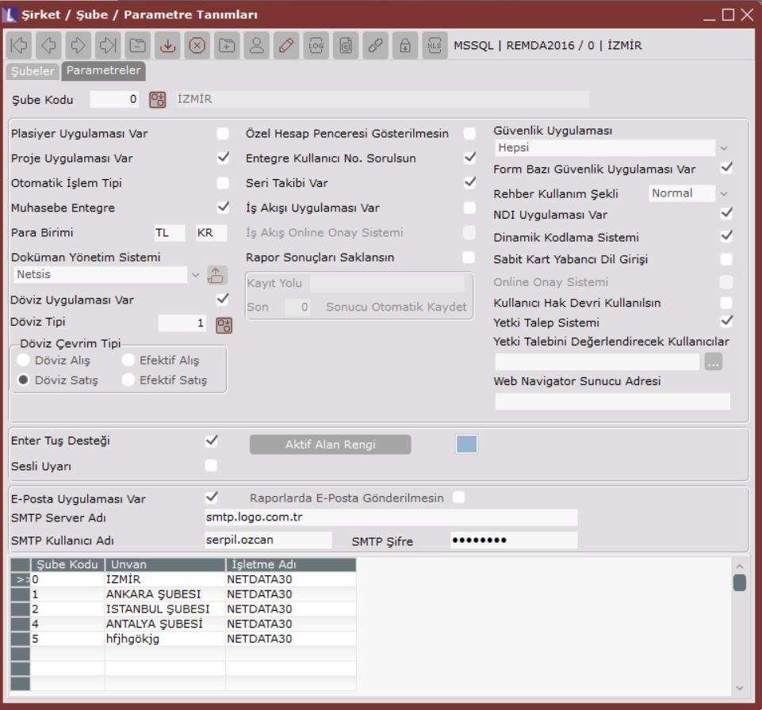

Bu durumda, içinde bulunulan şube ile NDI veri tabanı bağlantısının kurulacağı ve NDI paketinde tanımlanan ekran ve rehberlerin ilgili şubede kullanılmasına yönelik tanımlamaların yapılacağı menüler Yardımcı Programlar/Kayıt/NDI menüsü altında aktif hale gelecektir.

## **6.2.  NDI Bağlantı Tanımlamaları**

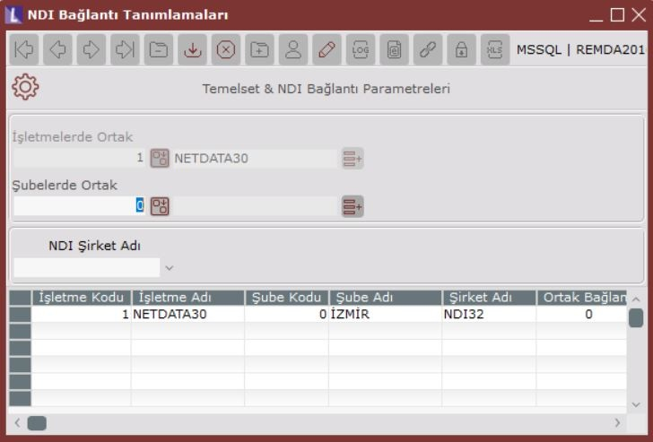

“NDI Uygulaması Var” parametresinin işaretlenmesi halinde Yardımcı Programlar/NDI menüsü altında aktif hale gelen alt menü seçeneğidir. Burada yapılan tanımlamalar ile, temelset paketindeki şubelerden hangi NDI şirketine,hangi kullanıcı ile bağlanılacağı belirlenmektedir.

**İşletmelerde Ortak:** Tanımlanan bağlantının hangi işletme(ler) için geçerli olduğunun belirlendiği alandır. Temelset-NDI bağlantısının tüm işletmelerde geçerli olması isteniyorsa bu sahaya -1, sadece belirli bir işletmede geçerli olması isteniyor ise de ilgili işletmenin kodu girilmelidir. Bu saha sadece Fusion paketinde bulunan merkez işletmede iken aktif olacaktır. Bağlantı tanımlaması, merkez işletmede yapılmıyor ise, işletme kodu sahası pasif olacak ve içinde bulunulan işletme kodu program tarafından getirilecektir.

**Şubelerde Ortak:** Tanımlanan bağlantının hangi şube(ler) için geçerli olduğunun belirlendiği alandır. Temelset-NDI bağlantısının tüm şubelerde geçerli olması isteniyorsa bu sahaya -1, sadece belirli bir şubede geçerli olması isteniyor ise de ilgili şubenin kodu girilmelidir. Bu saha sadece merkez şubede iken aktif olacaktır. Bağlantı tanımlaması, merkez şubede yapılmıyor ise, şube kodu sahası pasif olacak ve içinde bulunulan şube kodu, program tarafından getirilecektir.

**NDI Şirket Adı:** Bağlantı kurulacak NDI şirketinin belirlendiği sahadır. Sahanın sağ tarafında bulunan aşağı ok işaretine basıldığında NDI paketinde tanımlı şirketlerin isimleri listelenecektir. Yukarıda açıklanan İşletmelerde Ortak ve Şubelerde Ortak sahaları kullanılarak, birden fazla işletme ve şubenin tek bir NDI şirketi ile bağlantısını sağlamak mümkündür.

## **6.3.  NDI Nesneleri**

NDI paketinde hazırlanan ekran ve rehberlerin listelendiği ve bu nesnelerin temelset modüllerine eklenmesi için kullanılan menüdür. Bu menünün aktif olması için, Yardımcı Programlar/Şirket/Şube/Parametre Tanımları bölümünden “NDI Uygulaması Var” parametresinin işaretlenmiş olması gerekmektedir. Temelset içinden kullanılacak her bir NDI nesnesi, bu bölümde mutlaka tanımlanmalıdır.

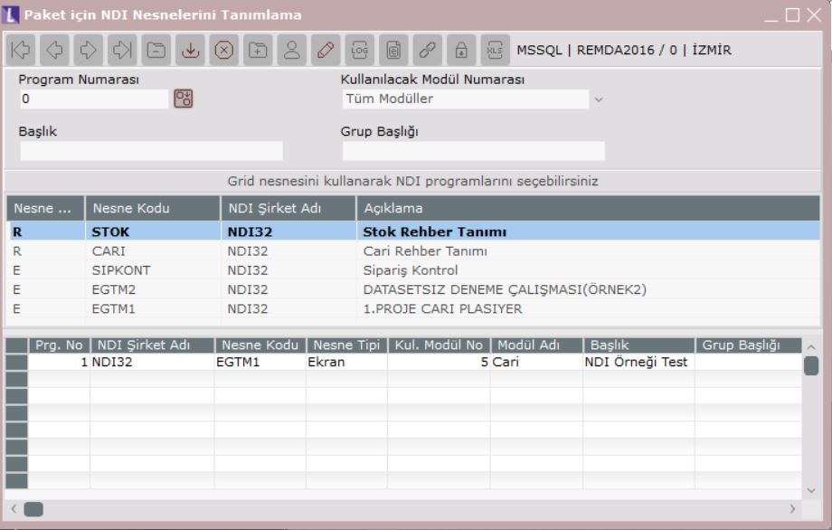

**Program Numarası:** Temelsete eklenen her bir NDI nesnesine tekrarsız serbest bir numara verilmelidir. Verilen bu program numaraları daha sonra kullanıcı işlemleri modülünde, kullanıcılara nesne ile ilgili hakların belirlenmesi sırasında gerekecektir. NDI paketinde tanımlanan nesne ve rehberler, temelset paketine eklendikten sonra, Admin yetkisine sahip olmayan kullanıcılar için, bu nesnelere ait hak tanımlaması yapılacaktır. Dolayısıyla, temelset paketinde bulunan, Kullanıcı İşlemleri/Kullanıcı Program Yetkileri tanımlama bölümünde, NDI Uygulamaları başlıklı modül altında (5000 numaralı modül), bu nesnelerin belirli bir program numarası ile listelenmesi gerekmektedir. Eklenen nesnelere ait yetki tanımlamaları ile ilgili detaylı bilgi dokümanın ilerleyen bölümlerinde anlatılmaktadır.

**Kullanılacak Modül Numarası:** NDI paketinde tanımlanan ekranların, hangi temelset modülünde kullanılacağının belirlendiği sahadır. İlgili ekranın bütün modüllerde kullanılması isteniyorsa Tüm Modüller, sadece belirli bir modülde kullanılması isteniyorsa da, ilgili modül seçilmelidir. NDI’da tanımlanan rehberlerin temelset paketine eklenmesi aşamasında, burada seçilen Kullanılacak Modül Numarası bilgisinin herhangi bir geçerliliği yoktur. Rehberler, temelset paketi içinden hazırlanan diğer ek rehberler gibi tüm modüllerde kullanılabilecektir. 

**Başlık:** Eklenen ekran ve rehberlerin başlık bilgisi olup, Kullanıcı İşlemleri/Kullanıcı Program Yetkileri tanımlama bölümünde, bu sahada belirlenen isimleri ile listeleneceklerdir. Ayrıca, tanımlı ekranların Temelset modüllerine eklenmesi halinde, ekranlar için bu sahada girilen başlık bilgileri, modül ana menüsüne gelecek olan NDI Uygulamaları menü başlığı altında listelenecektir. 

**Grup Başlığı:** Modül ana menüsüne eklenen ekranın, menüde bir alt başlık altında listelenmesi isteniyorsa kullanılacak sahadır. Nesne, ilgili modüldeki NDI Uygulamaları menüsünde, tanımlamada verilen grup başlığı altında listelenecektir. 

  

Program numarası, kullanılacak modül numarası bilgisi, Başlık bilgisi ve isteniyorsa grup başlığı bilgisi girildikten sonra, eklenecek olan nesne, NDI paketinde hazırlanan nesnelerin bulunduğu listeden seçilmektedir.

  

**Dikkat!** NDI paketinde tanımlanan ekran ve rehberlerin bu listede görüntülenmesi ve dolayısıyla temelset paketine eklenebilmesi için, ilgili ekranın NDI paketindeki tanımlamaları sırasında seçilen veri tabanı bağlantı koduna ait tanımlamada paket bilgisi olarak Temelset ve Hesaplanacak seçeneklerinin işaretlenmesi gerekmektedir.

  

Ayrıca, NDI paketinde ekran tanımlaması yapılırken form tipi olarak Normal seçilmesi gerekmektedir. Child olarak tanımlanan ekranlar temelset paketine eklenemeyecektir.

Birden fazla NDI şirketinin olması ve bunlardan birisi için, içinde bulunulan şube ile bağlantı tanımlanmış olması halinde, bu listede, bağlantı tanımlaması yapılmış olsun ya da olmasın, tüm NDI şirketlerinde tanımlanan nesneler görüntülenecektir. Ancak, bağlantı tanımlanmamış NDI şirketinde oluşturulan nesneler, bu bölümden temelset menüsüne eklenebilmesine rağmen, menüde görülemeyecektir. Bu yüzden, nesnelerin tanımlı olduğu NDI şirketi için mutlaka NDI-temelset bağlantı tanımlamasının yapılmış olması gerekmektedir.

**Grid ile NDI Nesneleri Seçimi:** Bu listede bulunan nesneler, Nesne Tipleri bazında sıralanmaktadır. Nesne Tipi sütununda **E** bilgisi olması halinde ilgili nesnenin ekran, R olması halinde ise, nesnenin rehber olduğu anlaşılmaktadır.

Nesnenin seçimi için, nesne üzerinde farenin sol tuşuna iki kez tıklamak yeterlidir. Bu durumda aşağıdaki onaylama ekranı gelecektir.

  

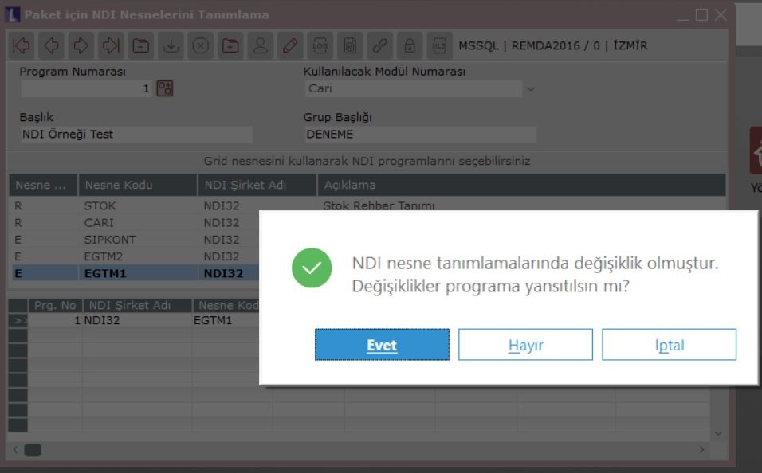

Yapılan tanımlamalara bağlı olarak, seçilen nesnenin temelset paketine eklenmesi için onaylama ekranında Evet butonuna basılmalıdır. Eğer, nesnenin eklenmesi istenmiyor ise İptal tuşuna basılmalıdır.

Eklenen nesneler ile ilgili değişiklik yapılması isteniyor ise, ilgili tanımlama ekranın en altında bulunan gridden seçilmeli, istenen değişiklik yapılarak tekrar kaydedilmelidir. Eklenen nesneleri temelset paketinden çıkarmak için ise, çıkarılması istenen nesneye ait tanımlama seçildikten sonra, klavyede bulunan F7 tuşuna ya da araç çubuklarındaki kayıt sil butonuna basılması yeterlidir.

  

Kaydet

Kaydet

Kaydet

Kaydet

Kaydet
