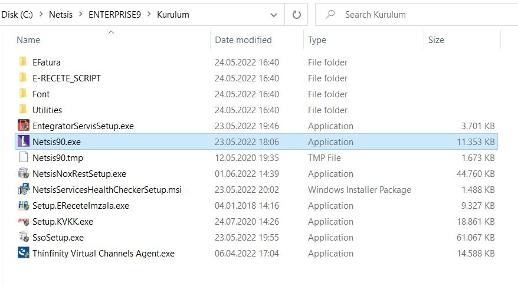
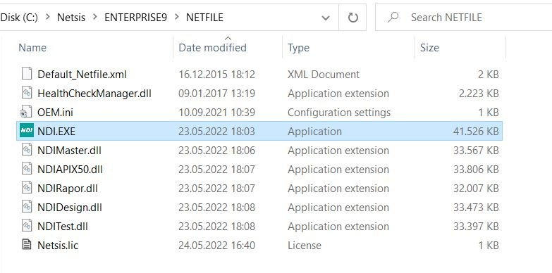
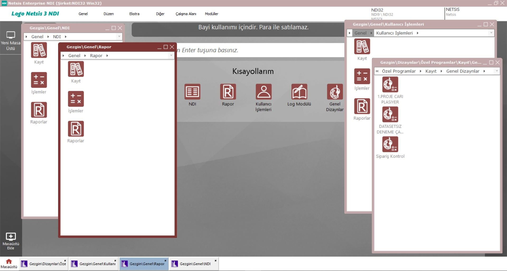

> Bu sayfa Logo DYS "Netsis Uyarlama Araçları" dokümantasyonunun bir kopyasıdır. İçerik Logo Yazılım'a aittir. Kaynak: [NDI Kurulum](https://dys.logo.cloud/external?cid=942c9234-ce4c-44de-a5a8-11db4fa140d4&link=1b654cdd-c26d-4b4d-a426-352c3ec8f0dd&tenantId=cdd87e13-3009-4dd1-a5b8-2a005c0e58da&hideName=True&locale=tr_TR)

# NDI Kurulum

# Yükleme ve Kurulum

NDI kurulumu için

-   ssosetup.exe çalıştırılmış ve **Merkezi Kimlik Yönetim** uygulaması yüklenmiş olmalıdır.
-   Lisans NDI kullanımını kapsamalıdır.

Uygulama kurulum adresi [http://webftp.netsis.com.tr/](http://webftp.netsis.com.tr/) dir. Bu paylaşım adresinden istenen uygulama kurulumu indirilebilir. **_Sadece_** _Müşteri ya da çözüm ortaklarına verilen kullanıcı/şifre bilgileri ile ftp adresine erişim sağlanabilir._

NDI kurulumu için lokaldeki kurulum dizininden Netsis90.exe çalıştırılır.

Kurulum sihirbazından sunucu kurulumu seçilir ve sadece NDI kurulumu için aşağıdaki seçimin yapılması gerekir.

Kurulum sonunda aşağıdaki NetFile dizini oluşur.

Veri tabanı sunucu üzerinde NDI için veritabanı oluşturulur. Aşağıdaki örnek SqlServer dan alınmıştır.

Kurulum sonrasında tüm paketlerden bağımsız olarak kendi ikonu veya start/run bölümünden çalıştırılabileceği gibi, istenirse bağlantılı bir Netsis paketinden (ör: Temelset) çalıştırılabilir.

NDI çalıştırıldığında, bağlanılacak şirket, kullanıcı isim ve şifre bilgileri sorgulanacaktır. NDI yüklendiğinde, NDI uygulamalarının tasarımı ile ilgili verilerin saklanacağı default bir şirket açılacaktır.

NDI uygulamasında farklı uygulamaların tasarım bilgilerini saklamak amacıyla farklı şirketler açılabilir.

Ayrıca NDI uygulamalarının verilerinin, NDI şirketinde bulunması gerekmemektedir.

Farklı veri tabanlarına ulaşan uygulamalar tasarlanabilir. NDI kullanıcıları, Kullanıcı İşlemleri modülünde tanımlanır ve şifreleri belirlenebilir.

# NDI Çalıştırma

NDI aracılığıyla veri giriş ekranlarının tasarlanabilmesi için öncelikle çalışılacak tabloların veri tabanı üzerinde var olması gerekir.

Tabloların oluşturulması, veri tabanı ve SQL bilgisi gerektirmektedir. Ayrıca hazırlanacak uygulamaya göre tabloların tasarlanması, diğer tablolarla ilişkilendirilmesi, ekranların ve raporların içeriği vb. analiz çalışmaları da NDI’da tasarıma başlanması öncesinde yapılmalıdır. Analiz çalışmaları da bir miktar sistem analizi bilgisi ve tecrübesi gerektirmektedir.

Tablolar kullanım amaçlarına göre istenilen bir veri tabanı içinde olabilir. ( Default oluşturulan veri tabanları : DEM9, ENTERPRISE9, NDI9, NETSIS, PER9 )

_NDI Giriş Ekranı_

_NDI Ana Ekran_

Üst bölümdeki menü çubuğu Dosya, Genel ve Yardım seçeneklerinden oluşmaktadır.

Kurulum adımları sonrası NDI projesi geliştirmeye başlamak için [tıklayınız](ndi-baslangic.md).
